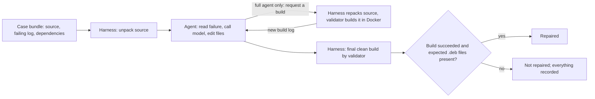

# Design Document — Demo 2

**Team:** Anthony Capraru, Austin Li, Joonseo Moon, Juliette Jacques, Owen Zhang
**Mentor:** Minghua Ma, Microsoft
**Branch:** `demo-2`. Last updated 21 October 2026.

> **TA: to reproduce our results, go straight to [§5](#5-how-to-reproduce-our-results).** It starts from launching a new EC2 instance and gives every command, its run time and its expected output. §§1–4 explain what the system is and what we found.

## 1. What we built

**The problem.** Build-Bench is a competition benchmark of Debian software packages that build on one CPU architecture (for example x86-64) but fail to build on another (for example ARM64). Each benchmark **case** contains the package's source code, the failing build log, and frozen copies of every dependency, so the failure can be reproduced exactly. A repair counts only if the organizers' **validator**, an official build tool, rebuilds the edited package from scratch on the target architecture and produces the expected `.deb` files.

**Our system** is an LLM agent that reads the failure, edits the package's source files, and hands the result to the validator. It has three parts:

| Part | What it is | Where it runs |
| --- | --- | --- |
| **Agent** | Our Python program that calls the model and edits files. Two versions, described below. | Inside `buildbench-starter-kit-0.1.0-rc.2/agents/`. It sees only a copy of the package source and never runs builds itself. |
| **Harness** | Our test driver (`harness/`). It sets up each case, runs the agent, packs the edited source back into a Debian source package, calls the validator, and records the result. | On the host machine (an AWS EC2 Linux server). |
| **Validator** | The organizers' build tool, shipped inside each case **bundle** (a downloaded archive with the case and a Docker image). | In a **Docker container** that the harness starts on the host. This is where Docker comes in: the harness uses the host's Docker to run the validator. The agent never gets Docker access. |

The model is `gpt-oss-120b`, an open-weight model that we call through Amazon Bedrock's OpenAI-compatible API. During the competition the organizers provide the model through their own endpoint. We do not train or fine-tune it.

### The two agents

- **One-shot agent (the baseline).** It sends the model the last 500 lines of the build log plus a fixed list of common build files (`debian/rules`, `debian/control`, `CMakeLists.txt`, `Makefile`, `setup.py`, `Cargo.toml` and a few others). The model replies once with a list of exact text replacements. The agent applies the ones that match and stops. It never sees whether its change worked. It is frozen at git tag `one-shot-v1` so later versions have a fixed point of comparison.
- **Full agent (our extension).** It works in a loop. It can call read-only tools to list, search and read any file in the package, propose edits, and ask the harness for a build. It then reads the new build log and tries again until it succeeds or runs out of budget (attempts, builds, tokens, turns and time). Before applying edits it checks that each one matches the file exactly, and it keeps track of which earlier attempt came closest.



### What counts as a repair

A run counts as **repaired** only if the validator's final, separate build reports `succeeded` **and** its check of the expected output files passes. An edit being applied, or the model claiming success, does not count. Every run is recorded, including failures. If a case already builds before any edit, it is recorded as `case_not_failing` and gets no credit.

## 2. Key design decisions

| Decision | Why, and what it costs |
| --- | --- |
| Keep a frozen one-shot baseline | Gives a fixed point to measure improvements against. It can't see files outside its fixed list or learn from a failed build. |
| Edits are exact text replacements in existing files under `input/` | The model can't run shell commands or touch anything else, so every change is visible in a diff. The model must quote file text exactly, and it often gets this wrong. The full agent returns a specific error message so the model can correct it. |
| The harness, not the agent, runs builds | Matches the competition rule that agents get no Docker or build access. The full agent's in-loop builds go through the harness, which only exists in our local setup. |
| Independent final validation | A plausible-looking patch that doesn't build gets no credit. |
| Debian source repacking in the harness | The validator consumes a Debian source package, not loose files, so the harness rebuilds it with `dpkg-source` after each edit. |

Approaches we tried and dropped (details in [full-agent.md](full-agent.md) and [part5-findings.md](part5-findings.md)): editing in small groups of three changes, which was too slow for package-wide problems; larger token budgets alone, which didn't fix wrong or repeated edits; and summarizing compiler errors, which discarded details the model needed.

## 3. Results

From one recorded run of every case with each agent (19 October 2026). The case list is rcran (the organizers' single downloadable example case) plus the ten public development cases.

| | One-shot | Full agent |
| --- | ---: | ---: |
| Cases run | 11 | 11 |
| **Repaired** | **0** | **1 (rcran)** |
| Development cases repaired | 0/10 | 0/10 |
| Blocked before the package build started | 5 | 5 |
| Already building, no repair needed | 1 | 1 |

What this shows:

- **The pipeline works end to end.** On rcran, the full agent found an x86-only CPU instruction setting (`HAVE_MM_PREFETCH`), turned it off, and the validator's clean build produced the expected ARM64 package.
- **The five "blocked" cases** are the ARM64 → x86-64 direction. Their builds crashed in the x86 emulator (QEMU) during setup, before our code mattered, so they don't measure repair ability.
- **The four remaining development cases** (including a large Rust package) were not repaired by either agent. A hand-assisted Rust fix does build, which shows that editing the source is enough. Our agent hasn't found that fix on its own.

Full case-by-case results: [demo2-comparison-diagnostics.md](demo2-comparison-diagnostics.md). Raw records: `docs/evidence/demo2/paired-retest/`.

## 4. Limitations and next steps

- **Repair rate is low.** One repair in 22 runs. Our proposal promised a working prototype and evaluation coverage for Demo 2, not a minimum repair rate. Improving it is the Demo 3 goal.
- **Reverse-direction cases need a working emulator setup** before they can be evaluated.
- **Results vary between runs** because the model's output varies.
- **The competition's hosted platform isn't qualified yet.** It provides the model differently and doesn't allow in-loop builds. Notes and plan: [hosted-submission-notes.md](hosted-submission-notes.md).
- **Demo 3:** controlled repeated runs, measuring whether build feedback and history help, and fixes for the edit-matching failures above.

## 5. How to reproduce our results

**Tested on a fresh instance (21 October 2026).** A team member who launched a new instance ran Experiments 1, 2 and 5 exactly as written below, and the dry run of Experiment 4. The results matched the expected outputs given here.

### 5.0 What you need

| Item | Requirement |
| --- | --- |
| Machine | AWS EC2 `m7g.xlarge` (ARM64, 4 vCPU, 16 GiB RAM), 80 GiB disk, region `us-east-1`. Native ARM64 Linux is required; the scripts refuse to run on macOS or x86. |
| Operating system | Ubuntu Server 24.04 LTS, ARM64 |
| Tools | Python 3.12 (Ubuntu's built-in; standard library only, no `pip install`). Docker, `dpkg-dev`, git, QEMU and tmux from Ubuntu's package manager (§5.2). |
| Accounts | GitHub read access to this repository, and an AWS account that can launch EC2 and use Amazon Bedrock. The case bundles download without an account. |
| Our code | This repository at tag `demo2-ta-v1`. The starter kit is committed inside it. |
| Model | Amazon Bedrock, `us-east-1`, model `openai.gpt-oss-120b-1:0`. Needed for Experiments 3–5 only. |
| Cost | EC2 is about $0.16/hour. Bedrock calls cost a few cents per run. Terminate the instance when finished. |

| Experiment | What it shows | Needs model key? | Time |
| --- | --- | --- | --- |
| Setup (§§5.1–5.4) | Instance ready, cases downloaded and verified, offline tests pass | No | About 45 min, mostly downloads |
| [1. Pipeline controls](#experiment-1-pipeline-controls-no-model) | A known fix is accepted and a non-fix is rejected | No | 6 min |
| [2. Scripted revision loop](#experiment-2-scripted-revision-loop-no-model) | The full agent recovers from a failed build | No | 6 min |
| [3. Live repair of rcran](#experiment-3-live-repair-of-rcran) | The model repairs a real case | Yes | 3–5 min per agent |
| [4. Full evaluation](#experiment-4-full-evaluation-all-22-runs) | The results table in §3 | Yes | About 2 h (up to 4 h) |
| [5. Starter kit readiness check](#experiment-5-starter-kit-readiness-check) | Our agents pass the competition's packaging and example test | Yes | 3–6 min per agent |

Experiments 1 and 2 give the same result every time. Experiments 3–5 depend on the model, so your counts may differ from ours. For those, check that the run completes and that any repair it reports passed the validator.

### 5.1 Launch the instance

In the AWS console, set the region to **US East (N. Virginia) `us-east-1`**. Open **EC2 → Instances → Launch instances** and set:

| Setting | Value |
| --- | --- |
| Name | `build-bench-demo2-ta` |
| Application and OS image | **Ubuntu Server 24.04 LTS (HVM), SSD Volume Type**, architecture **64-bit (Arm)** |
| Instance type | `m7g.xlarge` |
| Key pair | **Create new key pair**: name `build-bench-ta`, type RSA, format `.pem`. The browser downloads `build-bench-ta.pem`. |
| Network settings | Default VPC, **Auto-assign public IP: Enable**, a security group allowing **SSH (port 22)** from **My IP** only. |
| Configure storage | **80 GiB**, gp3 |

Click **Launch instance**. When the status check shows *2/2 checks passed*, copy the **Public IPv4 address**. In your **laptop terminal**, replace `YOUR_EC2_PUBLIC_IP` and run:

```bash
mkdir -p "$HOME/.ssh" &&
mv "$HOME/Downloads/build-bench-ta.pem" "$HOME/.ssh/" &&
chmod 400 "$HOME/.ssh/build-bench-ta.pem" &&
ssh -i "$HOME/.ssh/build-bench-ta.pem" ubuntu@YOUR_EC2_PUBLIC_IP
```

Answer `yes` to the host-key prompt. Expected: an `ubuntu@ip-...:~$` prompt. To reconnect later, run only the last line. **All remaining commands run on EC2.**

### 5.2 Install tools and clone the repository

```bash
sudo apt-get update &&
sudo apt-get install -y git python3 docker.io dpkg-dev xz-utils gzip tar ca-certificates tmux qemu-user-static binfmt-support &&
sudo systemctl enable --now docker &&
sudo usermod -aG docker "$USER"
```

Log out (`exit`) and reconnect so Docker works without `sudo`. Then:

```bash
mkdir -p "$HOME/Downloads" &&
git clone --branch demo2-ta-v1 https://github.com/ec528-fall26/build-bench.git "$HOME/build-bench-demo2" &&
cd "$HOME/build-bench-demo2" &&
{ lsb_release -ds; uname -m; docker info --format '{{.Architecture}}'; python3 --version
  docker --version; dpkg-source --version | head -1; git rev-parse HEAD; } | tee "$HOME/tool-versions.txt"
```

Expected: `Ubuntu 24.04.x LTS`, `aarch64` twice, `Python 3.12.x`, then the Docker, dpkg and commit lines. Keep `tool-versions.txt` with your results. Ubuntu doesn't let us pin exact package versions, so this file records the ones you got.

Start a **tmux** session now and run everything else inside it, so long steps survive a dropped connection:

```bash
tmux new -s demo2-ta
```

If you get disconnected, SSH in again and run `tmux attach -t demo2-ta`.

### 5.3 Download and verify the case bundles

The two bundles come from the [Build-Bench downloads page](https://matrix.cstcloud.cn/build-bench/data-downloads.html): "Local Validator Example rcran-v1" (387 MB) and "Local Validator Bundle: 10 Cases development-v1" (2.29 GB). The server is slow (about 0.6 MB/s for us), so allow up to an hour.

```bash
base=https://matrix.cstcloud.cn/build-bench/releases/local-validation
cd "$HOME/Downloads" &&
curl -fL -C - -O "$base/rcran-v1/buildbench-local-rcran-v1.tar.gz" &&
curl -fL -C - -O "$base/development-v1/buildbench-local-development-v1.tar.gz"
```

If a download stops, run the same command again to resume it. Check both files against the organizers' published hashes. Expected: two lines ending in `OK`.

```bash
cd "$HOME/Downloads" &&
sha256sum -c <<'EOF'
894e6a5d57acce17b8743d562a4e027c28dd81e549b08b94c3d29d360cac4538  buildbench-local-rcran-v1.tar.gz
542145b03b79cdf6deb4fdf960acaa1e21a9d24fbf52a19b1cf3be6707981d94  buildbench-local-development-v1.tar.gz
EOF
```

Extract each bundle, check its internal checksums, and load its validator Docker image. Expected: `OK` lines from `sha256sum`, a `Loaded image` line from Docker, then a passing check (rcran) or a list of ten cases (development).

```bash
tar -xzf "$HOME/Downloads/buildbench-local-rcran-v1.tar.gz" -C "$HOME" &&
cd "$HOME/buildbench-local-rcran-v1" &&
sha256sum -c SHA256SUMS && docker load -i runtime-image.tar.gz && bash run.sh --check
```

```bash
tar -xzf "$HOME/Downloads/buildbench-local-development-v1.tar.gz" -C "$HOME" &&
cd "$HOME/buildbench-local-development-v1" &&
sha256sum -c SHA256SUMS && docker load -i runtime-image.tar && bash run.sh --list
```

Confirm that the ten cases are the ones we evaluated. Expected: ten `OK` lines, then `10/10 case manifests match`.

```bash
cd "$HOME/build-bench-demo2" &&
python3 - "$HOME/buildbench-local-development-v1" <<'EOF'
import hashlib, json, sys
from pathlib import Path
bundle = Path(sys.argv[1])
cases = json.load(open('docs/evidence/demo2/development-cases.json'))['cases']
ok = 0
for case in cases:
    path = bundle / 'cases' / case['case_id'] / 'manifest.json'
    good = path.is_file() and hashlib.sha256(path.read_bytes()).hexdigest() == case['manifest_sha256']
    ok += good
    print('OK ' if good else 'BAD', case['case_id'])
print(f'{ok}/{len(cases)} case manifests match')
sys.exit(ok != len(cases))
EOF
```

### 5.4 Offline tests and the recorded configuration

These run our unit tests and recompute the §3 table from the saved run records. They need no Docker and no model key, and take under a minute.

```bash
cd "$HOME/build-bench-demo2" &&
env -u BB_MODEL_TRACE -u BB_REPAIR_STRATEGY -u BB_REVIEW_EDITS \
  -u BB_AGENT_USE_EVIDENCE_MANAGER -u BB_AGENT_USE_TOOLS \
  -u BB_AGENT_USE_BUILD_FEEDBACK -u BB_AGENT_USE_HISTORY \
  python3 -m unittest discover -s tests/full-agent -p 'test_*.py' &&
python3 -m unittest discover -s harness/tests -t . &&
python3 -m unittest discover -s tests/demo2 -p 'test_*.py' &&
python3 scripts/demo2_evidence_report.py
```

Expected: `Ran 320 tests ... OK`, `Ran 79 tests ... OK`, `Ran 15 tests ... OK`, then a report that includes:

```text
Latest paired retest (one repeat; raw verdicts retained):
one-shot 0 / 11 repairs; 5 setup-blocked; 1 already building
full-agent 1 / 11 repairs; 5 setup-blocked; 1 already building
```

Our recorded evaluation used the agent code at commit `001f3b9` with larger full-agent budgets than the defaults. The next command creates a second copy of the repository at that commit with those budgets. It checks every source file against its recorded hash, so you run exactly the code we ran. It also splits the ten-case bundle into one folder per case, which is the layout the experiment scripts expect.

```bash
python3 scripts/demo2_prepare_recorded.py --out "$HOME/build-bench-demo2-recorded" &&
cd "$HOME/build-bench-demo2-recorded" &&
cat ta-recorded-profile.json &&
python3 -m harness.case_views "$HOME/buildbench-local-development-v1" "$HOME/bb-cases"
```

Expected: the profile prints the budgets (12 attempts, 10 builds, 1,000,000 tokens, 80 turns, 200 tool calls, 7,200 s) with no error. **Experiments 1–4 run in `~/build-bench-demo2-recorded`.**

### Experiment 1: Pipeline controls (no model)

This experiment runs rcran twice with fixed, hand-written edits instead of the model. One edit is the known correct fix, and the other only adds a comment. It checks that the harness and validator accept a real fix and reject a fake one.

```bash
cd "$HOME/build-bench-demo2-recorded" &&
python3 scripts/demo2_demo.py controls \
  --bundle "$HOME/buildbench-local-rcran-v1" \
  --out "$HOME/buildbench-experiments/ta-rcran-controls-01"
```

Expected (about 6 min): two JSON summaries, then the final line.

```text
Starting positive; evidence: ...
{ ... "run_id": "positive", "repaired": true,  "termination_reason": "build_succeeded", ... "check_error": null }
Starting negative; evidence: ...
{ ... "run_id": "negative", "repaired": false, "termination_reason": "build_failed",    ... "check_error": null }
Pipeline completed. Live not-repaired results are valid outcomes, not claimed successes.
```

`"usage"` shows `null` tokens because no model is called. Any non-null `check_error` means the check failed, and the script exits with code 2.

### Experiment 2: Scripted revision loop (no model)

This experiment runs the full agent's loop with pre-written model replies: a wrong fix first, then the right one. It shows that the agent reads a failed build log and tries again until the build succeeds.

```bash
python3 scripts/demo2_demo.py revise-replay \
  --bundle "$HOME/buildbench-local-rcran-v1" \
  --out "$HOME/buildbench-experiments/ta-rcran-revise-01"
```

Expected (about 6 min): one summary with `"repaired": true`, `"termination_reason": "build_succeeded"` and `"check_error": null`, then the `Pipeline completed.` line. The script also confirms that at least one failed build came before the successful one.

### Model key (needed for Experiments 3–5)

In the AWS console, go to **Amazon Bedrock** in region `us-east-1`, then **API keys → Short-term API keys → Generate**. The key lasts up to 12 hours ([AWS instructions](https://docs.aws.amazon.com/bedrock/latest/userguide/api-keys-generate.html)). Paste this block into the EC2 tmux shell, then paste the key at the prompt. The key is not shown as you paste it.

```bash
read -r -s -p 'Paste short-term Bedrock API key for us-east-1: ' BB_MODEL_API_KEY
export BB_MODEL_API_KEY
printf '\n'
export BB_MODEL_BASE_URL='https://bedrock-runtime.us-east-1.amazonaws.com/openai/v1'
echo "key length: ${#BB_MODEL_API_KEY}"
```

Expected: a nonzero key length. **The key exists only in this shell.** A new tmux window, session or SSH login won't have it, so paste the block again there.

### Experiment 3: Live repair of rcran

These runs repeat Experiments 1–2 with the real model, once per agent.

```bash
python3 scripts/demo2_demo.py live-one-shot \
  --bundle "$HOME/buildbench-local-rcran-v1" \
  --out "$HOME/buildbench-experiments/ta-rcran-one-shot-01"
python3 scripts/demo2_demo.py live-full \
  --bundle "$HOME/buildbench-local-rcran-v1" \
  --out "$HOME/buildbench-experiments/ta-rcran-full-01"
```

Expected (about 3 min and 5 min): one summary each with `"check_error": null` and real token counts in `"usage"`, then `Pipeline completed.` `"repaired"` may be `true` or `false`. In our recorded run, the full agent repaired rcran and one-shot did not.

### Experiment 4: Full evaluation (all 22 runs)

This experiment reproduces the §3 table: 11 cases × 2 agents. First, turn on x86 emulation, which the five ARM64 → x86-64 cases need:

```bash
sudo update-binfmts --enable qemu-x86_64 &&
cat /proc/sys/fs/binfmt_misc/qemu-x86_64
```

Expected: `enabled`, and a `flags:` line containing `F`. Then preview the schedule without running anything:

```bash
cd "$HOME/build-bench-demo2-recorded" &&
python3 scripts/demo2_retest.py \
  --rcran "$HOME/buildbench-local-rcran-v1" \
  --views "$HOME/bb-cases" \
  --out "$HOME/buildbench-experiments/ta-paired-recorded-01" \
  --dry-run
```

Expected: `22 live runs: 11 cases × 2 agents × 1 repeat(s). No calls/builds started.` and 22 job names. To run it, repeat the same command **without** `--dry-run`.

Expected (about 2 h, up to 4 h): progress lines `[1/22] ...` to `[22/22] ...`, with long quiet periods during builds, ending with `Schedule complete. Read results.md and coverage.json; already-building cases are not repairs.` The output folder's `results.md` has one row per case and agent. Compare it with §3. As in our run, expect the five ARM64 → x86-64 cases to fail during setup. If the run stops partway (for example, the key expired), paste a new key and rerun the same command with `--resume` added.

### Experiment 5: Starter kit readiness check

`./bb ready` is the competition starter kit's own test. It validates the agent's packaging, runs the agent on a small example package called `hello`, and builds the result. By default, the kit runs the agent with no network access. For this local test we changed the kit's runner (`runner/run-agent-case.sh`) so that `BB_LOCAL_AGENT_NETWORK=bridge` turns on network access and the model key is passed into the agent's container. Without that change, the agent cannot reach the model. This experiment runs in the **main** checkout, not the recorded one, and in the shell that holds the key:

```bash
cd "$HOME/build-bench-demo2/buildbench-starter-kit-0.1.0-rc.2" &&
export BB_VALIDATOR_IMAGE='ghcr.io/terriyyy/buildbench-validator-runtime@sha256:11151f88f6b12c578b9c9fafd0420d6da27c6969b5909aaa4c51e78dd9acd7c7' &&
export BB_EXAMPLE_ASSETS_IMAGE='ghcr.io/terriyyy/buildbench-example-assets@sha256:98bdf0f445cf0296f67ffc8b4601ab1cb1f82b957f84bd9739276f5659cdde54' &&
docker pull "$BB_VALIDATOR_IMAGE" && docker pull "$BB_EXAMPLE_ASSETS_IMAGE" &&
export BB_LOCAL_AGENT_NETWORK=bridge &&
./bb ready --agent ./agents/full-agent --output runs/readiness/ta-full-agent/full-agent.zip --json
```

```bash
./bb ready --agent ./agents/one-shot --output runs/readiness/ta-one-shot/one-shot.zip --json
```

A pass looks like this:

```text
✓ Agent submission is valid
✓ Example Case prepared
✓ Initial build failure reproduced
✓ Agent completed
✓ Canonical patch generated
✓ Final validation succeeded
[1/1] hello succeeded
...
"status": "succeeded", "exit_code": 0
```

**This result varies between runs.** `hello` is an RPM package, but our agents are built for Debian, so the model sometimes gives up without editing. You then see `✓ Agent completed`, `Agent made no allowed textual change`, `Passed: 0/1` and exit code 5. That is a valid model outcome, not a setup error. In our runs, the full agent passed 2 of 3 times. Its passing package hash (`153413be…`) was identical each time. One-shot passed 1 of 3 times, because its fixed file list doesn't include `.spec` files. To confirm the model was actually called, print the agent's message using the run folder shown after `Summary:`:

```bash
grep -o '"message": *"[^"]*"' runs/tests/<agent>/<run>/cases/hello/agent-result.json
```

A message explaining the model's reasoning means the setup works. `No model API key configured` means the key didn't reach the agent: check that you're in the shell where you pasted it.

### 5.5 When you're done

Copy anything you want to keep from `~/buildbench-experiments/`, then **terminate** the instance in the EC2 console. A stopped instance still bills for its disk.

## More detail

- [one-shot-agent.md](one-shot-agent.md) and [full-agent.md](full-agent.md): how each agent works, in depth.
- [demo2-comparison-diagnostics.md](demo2-comparison-diagnostics.md): case-by-case results with log evidence.
- [part5-findings.md](part5-findings.md): earlier experiments, including the hand-assisted Rust repair.
- [hosted-submission-notes.md](hosted-submission-notes.md): the competition's hosted platform and our plan for it.
- [design-proposal.md](design-proposal.md): the original proposal and milestones.
