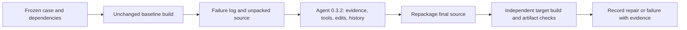

# Design Document — Demo 3

**Team:** Anthony Capraru, Austin Li, Joonseo Moon, Juliette Jacques, Owen Zhang

**Mentor:** Minghua Ma, Microsoft

**Demo branch:** `demo-3` · **Selected agent:** `full-agent-v032`, version **0.3.2+demo3.refactor**

**Updated:** 16 November 2026

> **TA: start at [§5](#5-ta-reproduction-guide).** For a quick code check, run the two offline test suites in §5.5. For starter-kit readiness, use §6 and retain its actual verdict. The full reproduction guide starts with a fresh ARM64 EC2 instance and ends with an eleven-case evaluation; it takes several hours. A short rcran-only run is available first. New refactored-agent campaigns are in progress; no final repair count is claimed.

## 1. What we built

Build-Bench contains Debian source packages that fail when built for a different CPU architecture. Our agent investigates a failure log and package source, proposes edits, and leaves the final source for independent validation. A repair is successful only when the target build succeeds **and** produces the expected binary artifacts.

| Component | Responsibility | Location |
| --- | --- | --- |
| Agent 0.3.2 | Select evidence, inspect source with tools, propose and apply edits, retain conversation history | `buildbench-starter-kit-0.1.0-rc.5/agents/full-agent-v032/` |
| Local harness | Build the unchanged baseline, unpack a fresh worktree, invoke the agent, repackage Debian source, perform final validation and record outcomes | `harness/` |
| Official validator | Build the source for the target architecture using the frozen dependencies; validate binary artifacts | Docker image included in each downloaded validator bundle |
| Model | Generate repair decisions; no training or fine-tuning | Bedrock `openai.gpt-oss-120b-1:0`, `us-east-1` |

The agent has no direct Docker interface. The host-side harness runs the validator. In this Demo 3 configuration, **iterative build feedback is disabled**: the agent can inspect files and revise edits, but does not observe builds between edits. The harness still builds the original source and validates the final candidate.



If the unchanged baseline already succeeds, the harness records `case_not_failing`; the case receives no repair credit and the model is not called.

## 2. Design changes and frozen configuration

Demo 2's design included an agent that requested builds during its repair loop. This demonstration selects the historical 0.3.2 agent in a configuration without those requests. The main changes include:

- **Evidence and recognized patterns:** compiler diagnostics are presented with relevant source context. Recognizers identify evidence for Rust C-string signedness, x86 intrinsics on ARM, ARM outline-atomics helpers, and symbol mismatches. Their advice does not itself edit files.
- **More reliable edits:** narrowly constrained wrong-path recovery finds an exact match in a unique eligible file; export-removal and already-applied edits receive explicit handling.
- **Full-log tools and stopping rules:** new `read_log` / `search_log` tools inspect numbered log lines. No-build prompts explain that the original log does not change after an edit and tell the model to stop when its repair is complete.
- **Batch recovery:** preserve valid edits when another edit is stuck, permit source inspection during correction, and handle unique whitespace matches and required Debian flag exports.

Evidence selection, source-inspection tools and repair history already existed in Demo 2; they are retained capabilities, not entirely new Demo 3 features.
- **Environment repair:** pinned QEMU registration fixes the x86 execution problem on our ARM64 host. This is a host setup change, separately evaluated from agent repair quality.

See [the historical findings](no-build-live-findings.md) and [the selected version notes](demo-3-agent.md). The original agent source comes from `feaa5714d9a4c9738dee46c9190e4d81d05c43af`. The submitted readability refactor is commit `db555cd`, version `0.3.2+demo3.refactor`. Austin’s earlier November 16 sweep used `a0bd0db518f452d751267adbdc2f00516ad78c8d` (unrefactored 0.3.2); its partial results below must not be attributed to the refactor.

**Code-quality changes:** the refactor delegates the repair loop to named stages for budgets, tools, review, validation, application and candidate selection. Tool requests use a dispatch table with one handler per tool. Characterization tests compare controller requests, results and tool responses against the original implementation. This improves readability; it is not a new repair technique or proof of identical live model decisions. Model-client duplication remains documented because each agent must package independently. See [the refactor review](demo-3-code-quality.md).

### 2.1 What changed since Demo 2, and why

The core architecture remains an LLM-driven investigation and edit loop. Demo 3's contribution is a more explicit evidence-guided repair process under a **no-iterative-build-feedback constraint**, plus independently recorded final validation. The changes below distinguish the November 2–3 historical agent improvements from the November 16 readability refactor and reproduction work; they are not all new algorithms introduced by the refactor.

| Area | Specific change in the selected Demo 3 configuration | Why it matters and how it is checked |
| --- | --- | --- |
| Repair workflow | Disable iterative build feedback. The agent uses the original failure log, source inspection and edit feedback; the harness builds the unchanged baseline and independently validates the final candidate. | Separates reasoning without target-build access from final correctness checks. `0 loop builds` does not mean no baseline or final build occurred. Build-feedback support remains in the code but is disabled for this evaluation. |
| Architecture-specific diagnosis | `src/patterns.py` recognizes Rust C-string signedness, x86 intrinsic headers on ARM, ARM outline-atomics helpers and Debian symbol mismatches, and supplies relevant source evidence and repair advice. | Makes investigation specific to cross-architecture failure mechanisms. Recognizers advise the model; they do not automatically establish or apply a correct repair. |
| Log investigation and stopping | `read_log` and `search_log` expose numbered lines from the original log. No-build prompts explain that this log predates every edit and that stopping submits the candidate. | Gives access beyond a short excerpt and avoids interpreting historical errors as a new failed build. File tools and conversation history already existed in Demo 2 and are retained capabilities. |
| Batch-edit recovery | Preserve valid edits when another item exhausts correction; permit inspection during correction; repair uniquely identifiable indentation and wrong-path matches; discard duplicates, no-ops and already-applied edits. | Reduces loss of useful edits and repeated correction of changes already made. Ambiguous matches remain subject to validation rather than guessed replacements. |
| Debian recipe handling | Mechanically restore required `export` for supported `DEB_*_MAINT_*` additions, reject invalid insertion into continued variables, and handle export-removal edits explicitly. | Addresses how proposed compiler flags reach the build. These narrow checks are not the later general rules guard or output-verification gate. |
| Explicit resource limits | Record 8 edit attempts, 60 model turns, 120 tool calls and the token/time budgets in the configuration table below. | Makes the amount of investigation auditable. Larger budgets are configuration choices, not evidence of a better repair algorithm or a fair comparison to smaller-budget runs. |
| Repair-loop readability | `src/loop.py` delegates to named stages for budget checks, model responses, tool execution, correction/review, validation, application and candidate selection. | Addresses the TA's long/nested-function concern. For this selected source, `run_loop` changes from 634 lines / 68 `if` nodes to 23 lines / 0 `if` nodes; these AST spans include comments and blank lines and refer to a different revision from the TA's 503-line example. |
| Tool readability | `src/tools.py` uses a dispatch table and separate handlers; shared timeout, error and bounded-log-reading behavior remains centralized. | `_run_tool` changes from 338 lines / 36 `if` nodes to 6 lines / 1 `if` node. This reorganizes behavior; it does not claim faster package builds. |
| Regression evidence | Dedicated `tests/full-agent-v032` and separate harness tests; two characterization tests compare 17 controller scenarios and 11 tool requests against original behavior. | The observed 492 agent and 80 harness test passes support the refactor, not a new live repair score. Comparison covers requests, results, edited source and tool responses. |
| Reproduction and environment | Pin source and QEMU, check x86 execution, verify frozen bundles, specify model/region/configuration, and retain results. Provide an opt-in, separately labeled local network-enabled readiness helper. | Distinguishes environment recovery from source repair and addresses the missing setup instructions raised in Demo 2. Readiness status, live campaign results and hosted results remain separate evidence sets (§§3, 6–7). |

**Worked mechanism, not a new result claim:** for a Rust C-string signedness diagnostic, the recognizer collects relevant source and suggests the architecture-portable C character type. The model inspects callers and declarations, proposes a coordinated batch, and the controller checks and applies valid edits. With build feedback disabled, the model cannot claim those changes have compiled; the independent final validator determines whether the candidate repaired the package. The historical findings record an example, while the current campaigns must retain their own patches and verdicts.

**Scope and remaining limitations:** the model-client duplication noted by the TA is not resolved. Each agent remains independently packageable; a shared development source with reproducible vendoring and drift checks is future work. This selected agent does not include the later 0.5.x/0.6.x syntax guards, fresh-review experiments or output-verification gate. The refactor is intended to preserve the historical repair policy; scripted regression tests do not prove identical live model decisions. We claim engineering and evidence-handling improvements, not a new general repair algorithm or a demonstrated controlled increase in repair rate. Such a performance claim requires matched evaluations with complete outcomes, including failures and infrastructure errors.

### 2.2 Design decisions and alternatives

| Decision | Alternative considered or previously used | Rationale and tradeoff | Failure experience / remaining limitation |
| --- | --- | --- | --- |
| Investigate and edit without iterative target builds | Request a build after each repair attempt, as supported by the earlier local loop | Matches the selected no-build-feedback setting and separates agent reasoning from final validation; removes a strong source of corrective evidence | A plausible edit may still fail compilation or packaging. The original log is historical evidence, not confirmation of the current source. |
| Supply narrow architecture recognizers alongside model investigation | Rely entirely on generic prompting, or apply fixed repairs automatically | Source-grounded hints focus investigation while the model chooses the edit | Recognized patterns cover only some failures; advice can be incomplete and needs independent validation. |
| Recover only mechanically unambiguous edits and retain valid batch items | Reject the entire batch, or guess fuzzy replacements | Preserves useful edits without accepting ambiguous source matches | Historical findings describe wrong paths, indentation mismatches and already-applied edits consuming correction turns. Mechanical applicability does not establish semantic correctness. |
| Refactor into repair stages and tool handlers | Keep the long conditional functions, or redesign the repair policy at the same time | Makes control flow reviewable while isolating readability changes from behavior changes | Characterization tests exercise selected paths; they do not prove all possible model interactions equivalent. Independent agent packages still duplicate model-client code. |
| Retain the selected 0.3.2 policy in a separate directory | Replace it with newer development or overwrite the current agent | Preserves the demonstration's provenance and allows explicit selection | Historical results cannot be transferred automatically to the refactored copy; it needs its own live evaluation. |
| Use frozen validator bundles and pinned x86 emulation | Treat host-dependent build failures as repair failures, or use a moving emulator tag | Makes package inputs identifiable and isolates known environment failures | Prior x86 setup crashes left results undetermined. The QEMU smoke check establishes basic execution, not correctness of every target build. |
| Keep official offline readiness separate from an opt-in local network-enabled check | Silently modify the tracked runner or claim host credentials reach its sandbox | Makes the model-access difference reproducible and preserves the official kit | The offline runner blocks model access; a modified local pass is not hosted qualification. The model-enabled local mode passed on November 16 after QEMU setup (§7.3); no unchanged-offline or hosted pass is inferred. |

### 2.3 Evaluation configuration

| Setting | Demo 3 value |
| --- | --- |
| Agent selector | `--agent full-agent-v032` |
| Evidence manager / tools / history | Enabled (`1`) |
| Iterative build feedback | Disabled (`0`) |
| Repair strategy / review edits | `default` / disabled (`0`) |
| Agent limits | 8 edit attempts; 60 model turns; 120 tool calls; 3,000,000 cumulative model tokens; 1,800 seconds with 120 seconds reserved for stopping |
| Build requests inside the loop | Zero in this configuration; the class's default build budget is unused |
| Harness build timeout | Each manifest's build timeout plus 600 seconds |
| Input failure evidence in this rerun | A fresh unchanged baseline build, not an explicitly supplied historical log |
| Concurrency / repeats | One case at a time per host; one run per case per campaign. Three refactored-agent campaigns are underway on separate ARM64 hosts, with different case orders. See §3.1 for timestamped partial outcomes and host differences. |

Agent limits are research settings, not organizer limits. Total case wall time includes work outside the agent loop and can exceed 30 minutes. Do not substitute `--agent full-agent`: that directory contains newer development. Do not use `scripts/demo2_demo.py` for this experiment; it selects a different configuration.

## 3. Evidence and results status

| Evidence set | What can be claimed |
| --- | --- |
| Model-enabled local readiness (`8f75fdc`) | **Passed:** `bb ready` reported `succeeded`, exit 0; helper verified the 104,595-byte ZIP hash. Uses a temporary network-enabled runner and pinned QEMU 10.2.3. Initial infrastructure failure and successful rerun are recorded separately in §7.3; this is not hosted qualification or an eleven-case repair result. |
| Demo 2 paired retest | Historical one-shot 0/11 and full-agent 1/11, with five x86 setup failures and one already-building case; see [Demo 2 results](demo2-results.md) |
| Historical 0.3.2 evaluation | Reported 4/11: rcran, libunwind, rust-subversion, html-xml-utils. The html result is weak evidence because unchanged source also built locally. Four x86 outcomes were undetermined under QEMU. This is not a new controlled comparison. |
| Pinned QEMU setup | The [recorded workaround](evidence/qemu-fix-20261102/qemu-setup-and-diagnosis.md) and [five-case follow-up](evidence/qemu-fix-20261102/five-case-results.md) distinguish environment recovery from package repair. The fresh November 16 host also passed the x86 grep smoke test. |
| Austin’s November 16 unrefactored 0.3.2 sweep (`a0bd0db`) | **In progress, verified November 16 at 16:43:04 UTC (11:43 AM ET).** Eight cases finished: five repaired and three failed final builds. Libevtx was running; html-xml-utils and pybigwig were queued. Per-case results and provenance are in §3.2. This is a partial snapshot, not a final repair rate. |

**Refactored-agent evidence (`db555cd`):** 492 dedicated agent tests and 80 harness tests passed on the first two campaign hosts. Three independent eleven-case campaigns are now running with fresh baselines and no iterative build feedback. Their dated partial results are in §3.1, separately from Austin’s earlier unrefactored sweep and the historical 4/11 result.

The fresh sweep includes rcran plus libbpp-core, libbpp-qt, python-intbitset, ectrans, libmceliece, libunwind, rust-subversion, libevtx, html-xml-utils and pybigwig. Exact IDs are checked against `docs/evidence/demo2/development-cases.json` below.

Austin’s partial results above are operational evidence from that running host, not yet a committed raw-evidence archive. The initial invalid-key attempt was stopped and retained separately; it is not pooled with the authenticated sweep. The authenticated output directory is `~/buildbench-experiments/demo3-v032-20261116T135011Z` on the team host.

### 3.1 Accumulated case results

This table accumulates results from different tests and partially completed campaigns. “Repeat 1–4” identifies the source of an observation; it does not mean every case has four completed runs or that all runs form a controlled repeat experiment. Repeats 1–3 use the same refactored agent but differ in case order, coverage and host resources. Repeat 4 contains Austin’s unrefactored 0.3.2 sweep, verified at 16:43:04 UTC on November 16. Its different agent version and settings are documented below; it is not a fourth controlled repeat of the refactored agent. Unfinished or unavailable results are not counted as failures.

Repeats 1–3 use commit `db555cde6e88d126411f60516ae8321eff988404`, recorded agent `0.3.2+demo3.refactor+a2c50271ee37`, and served model `openai.gpt-oss-120b-1:0`. Evidence, tools and history are enabled; iterative build feedback and review edits are disabled; repair strategy is `default`. Wall time is total harness case time in seconds, including baseline and final validation when performed, not model latency alone.

| Case (target architecture) | Repeat 1 | Repeat 2 | Repeat 3 | Repeat 4 (Austin) |
| --- | --- | --- | --- | --- |
| rcran (arm64) | **Repaired · 186.1 s** | Not started | Not started | **Repaired · 211.3 s** |
| libbpp-core (amd64) | Failed build · 4,391.7 s | No edits applied · 2,092.0 s | Not started | **Repaired · 4,554.6 s** |
| ectrans (arm64) | Failed build · 236.1 s | Not started | Not started | Failed build · 335.4 s |
| libmceliece (arm64) | Failed build · 253.6 s | Not started | Failed build · 300.9 s | Failed build · 379.9 s |
| libbpp-qt (amd64) | Running | **Repaired · 1,781.0 s** | Not started | **Repaired · 1,913.9 s** |
| python-intbitset (amd64) | Not started | Running | Not started | Failed build · 1,347.8 s |
| libunwind (arm64) | Not started | Not started | **Repaired · 353.1 s** | **Repaired · 377.6 s** |
| rust-subversion (arm64) | Not started | Not started | Failed build · 691.9 s | **Repaired · 862.4 s** |
| libevtx (amd64) | Not started | Not started | Not started | Running |
| html-xml-utils (arm64) | Not started | Not started | Not started | Queued |
| pybigwig (amd64) | Not started | Not started | Running | Queued |
| **Completed cases / planned** | **4 / 11** | **2 / 11** | **3 / 11** | **8 / 11** |
| **Confirmed repairs among completed cases** | **1** | **1** | **1** | **5** |

Rcran is the separate smoke case; the other ten are the development cases. These partial repair counts are not an aggregate repair rate or a matched three-repeat comparison. For example, libbpp-core completed twice with different outcomes (`build_failed` versus `no_edit_applied`), while most other cases have no completed repeat yet. The model's stopping reason is distinct from final success: Repeat 2's libbpp-qt hit `attempt_budget`, but its retained candidate still passed independent validation.

#### Repeat key and evidence locations

Source logs and raw `record.json` files remain under `/home/ubuntu/buildbench-experiments/` on the corresponding host. Locations for Repeats 1–3 are retained in the structured evidence file; Repeat 4 locations are in §3.2. The [structured snapshot](evidence/demo3/partial-results-20261116T163923Z.json) is a transcription of the terminal reports, not a replacement for the full evidence archive.

| Repeat | Host / instance type | Configuration / evidence |
| --- | --- | --- |
| Repeat 1 | `172.31.68.209` / `m7g.xlarge` | Refactored `db555cd`; structured snapshot contains record locations; original case order, rcran first |
| Repeat 2 | `172.31.73.13` / `m7g.2xlarge` | Refactored `db555cd`; five amd64-target cases first |
| Repeat 3 | `172.31.74.145` / `m7g.xlarge` | Refactored `db555cd`; libunwind, rust-subversion and libmceliece first, rcran last |
| Repeat 4 (Austin) | `172.31.47.79` / `m7g.xlarge` | Original 0.3.2 at `a0bd0db`; eight completed records in `demo3-v032-20261116T135011Z`; details in §3.2 |


All hosts are ARM64; x86-target builds use the pinned QEMU 10.2.3 setup checked earlier. Instance types come from the observed EC2 configuration; the snapshots do not independently query instance metadata. In particular, Repeat 2 has a larger host, so these timings are not a controlled speed comparison. Case order and completed coverage also differ. Austin's unrefactored `a0bd0db` results above remain a separate configuration; they are not pooled into these refactored-agent experiments. At Austin’s request, these dated observations occupy Repeat 4 in the shared table, with their distinct configuration retained explicitly.

#### Completed-case metrics

Token values below are the recorded cumulative model usage. Applied edits come from each case's console summary. All nine completed evaluations reported zero loop builds; tool-call counts were not included in the snapshots and remain unknown. The two newly completed Repeat 3 failures are supported by console summaries; their token counts have not been collected and are shown as unknown.

| Case | Repeat | Wall time (s) | Model turns | Edit attempts | Applied edits | Input tokens | Output tokens | Agent termination |
| --- | --- | ---: | ---: | ---: | ---: | ---: | ---: | --- |
| ectrans | 1 | 236.1 | 9 | 1 | 1 | 62,563 | 8,011 | `model_stop` |
| libbpp-core | 1 | 4,391.7 | 50 | 8 | 9 | 840,223 | 48,773 | `attempt_budget` |
| libmceliece | 1 | 253.6 | 26 | 3 | 3 | 231,962 | 14,311 | `model_stop` |
| rcran | 1 | 186.1 | 4 | 1 | 1 | 31,576 | 1,069 | `model_stop` |
| libbpp-core | 2 | 2,092.0 | 5 | 0 | 0 | 43,353 | 3,124 | `model_stop` |
| libbpp-qt | 2 | 1,781.0 | 46 | 8 | 12 | 752,156 | 42,525 | `attempt_budget` |
| libunwind | 3 | 353.1 | 3 | 1 | 1 | 22,590 | 1,129 | `model_stop` |
| rust-subversion | 3 | 691.9 | 60 | 3 | 26 | Unknown | Unknown | `turn_budget` |
| libmceliece | 3 | 300.9 | 26 | 4 | 4 | Unknown | Unknown | `model_stop` |

The final verdicts above come from the harness summaries and records, not the model's self-assessment. Repeat 1's libbpp-core final build log separately showed a symbols-file parsing error (`(optional) is not a valid version`). Reasons for the other failed final builds have not been reclassified from model explanations alone. All completed harness processes exited zero; that indicates completed evaluation, not successful repair.

### 3.2 Austin’s unrefactored sweep: verified partial results

**Snapshot:** November 16, 2026, 16:43:04 UTC (11:43 AM ET). This updates the earlier 15:17 UTC observation and matches the presentation’s dated result table. These observations populate Repeat 4 (Austin) in §3.1. They remain a different configuration from the refactored-agent campaigns and are not pooled into a controlled repair-rate claim.

The host is `build-bench-demo-3` (`i-0e9c3560bdee7ffea`), an ARM64 `m7g.xlarge`. The repository is pinned to `a0bd0db518f452d751267adbdc2f00516ad78c8d`, selecting original `full-agent-v032` 0.3.2, not `0.3.2+demo3.refactor`. The model is Bedrock `openai.gpt-oss-120b-1:0`. Evidence, tools and history are enabled; iterative build feedback and edit review are disabled; strategy is `default`. Each case uses a fresh unchanged baseline and independent final validation. This is one sequential sweep with one scheduled run per case.

Per-case outcomes and wall times are shown in the existing §3.1 table under **Repeat 4 (Austin)**. Run suffixes 1–11 follow that table’s case order. All eight completed cases stopped with `model_stop`, except rust-subversion, which stopped with `turn_budget`.

**Coverage:** 8/11 completed, with 5 confirmed repairs and 3 failed final builds; 1 running and 2 queued. Of the ten development cases, seven had completed with four repairs; rcran is the separate repaired example. Unfinished cases are not failures. Rust reached its 60-turn limit, but its retained candidate passed final validation: agent termination and repair success are different fields.

The outcomes above were read directly from the eight completed `record.json` files in the authenticated output directory:

```text
/home/ubuntu/buildbench-experiments/demo3-v032-20261116T135011Z/
  demo3-20261116T135011Z-<run suffix>/record.json
```

Successful records reported `repaired: true` and `termination_reason: build_succeeded`; the three unsuccessful records reported `repaired: false` and `build_failed`. Durations come from the corresponding case summaries in `/home/ubuntu/demo3-setup/run-all.log`. All eight console summaries reported zero loop builds. The active process identified libevtx as case 9 at this snapshot. Raw records remain on the host and are not attached to this Markdown update. The earlier invalid-key run (`20261116T134558Z`) is excluded even though its messages remain in the combined console log.

Libbpp-core and libbpp-qt now have verified x86-target repairs after the QEMU setup change. This does not establish that every former setup blocker is repaired, nor isolate an agent improvement from the environment change. A final eleven-case score and controlled Demo 2/refactor comparison remain pending. Token and tool-call metrics are not supplied by this snapshot and must not be inferred from timings.

## 4. Claims and limitations

A single sweep does not establish the proposal's promised paired improvement: that requires three matched repeats for each compared configuration on the same ten development cases, under the same model, budgets and working QEMU environment. History ablation, token/wall-time comparisons and regression accounting remain separate work. Historical scores from different environments are context, not a controlled before/after result.

The evaluation protocol retains all eleven outcomes and distinguishes already-building cases, package failures, model failures and infrastructure failures. Rcran is reported separately from the ten development cases. The intended metrics are tokens (unknown values remain unknown), wall time, edit attempts, tool calls, termination reasons, migration direction and regressions. The partial evidence in §3 does not yet provide every metric. Build success does not prove unrestricted semantic correctness, especially when a patch disables tests, features or meaningful validation.

The guide below selects the submitted refactored agent (`db555cd`) and the six no-build-feedback settings. Austin’s earlier unrefactored sweep is retained as separate evidence. Fresh-host package installation, bundle verification, QEMU smoke testing and one live rcran repair were observed on November 16. The new convenience runner has local checks; it has not yet completed its own eleven-case end-to-end run. Accordingly, its reproduction procedure is provided without claiming a completed end-to-end convenience-runner result.

## 5. TA reproduction guide

### 5.0 Experiment index: claims, commands and expected observations

This index maps the document's testable claims to reproduction steps. Setup and downloads in §§5.1–5.4 are prerequisites, not repair experiments. Commands run on the configured Linux host from the stated repository directory. Historical results in §3 refer to their recorded commits; the commands below evaluate the explicitly selected refactored agent and may produce different live outcomes.

| Experiment / claim supported | Command or exact procedure | Runtime | Expected output and interpretation |
| --- | --- | --- | --- |
| **E1 — Refactored agent regression checks pass** (§2.1) | From the pinned repository root: `python3 -m unittest discover -s tests/full-agent-v032` followed in a separate process by `python3 -m unittest discover -s harness/tests -t .` (§5.5) | Observed on the two campaign hosts: about 1.4 s for the agent suite and 0.2 s for the harness; excludes setup | 492 and 80 tests respectively, both `OK`. No model calls or package builds. This supports regression coverage, not improved repair performance. |
| **E2 — Pinned emulator executes an x86 program on ARM64** (§2.2) | The complete pinned-image registration and grep smoke commands in §5.4 | Smoke command normally short; download/registration duration was not measured | QEMU version 10.2.3 from the image; enabled registered handler; GNU grep output and exit 0. A crash or nonzero exit is an environment failure to diagnose, not an agent repair result. |
| **E3 — Validator distinguishes a known repair from a non-fix** | The two `harness.run_case --agent one-shot --replay ...` commands in §5.5 | Current-host control runtime not measured; each command includes actual builds | Positive replay: `REPAIRED`; comment-only replay: `not repaired`. These are scripted pipeline controls, not autonomous one-shot or Demo 3 performance results. |
| **E4 — Measure autonomous repairs with no iterative build feedback** (§§1–3) | Save the §5.6 helper, preview with `python3 "$HOME/demo3-ta/run.py" --out "$HOME/buildbench-experiments/demo3-ta-01" --dry-run`, then omit `--dry-run` to execute. Use `--only-rcran` with a separate output directory for the shorter smoke run | Full refactored sweep duration not yet measured; allow several hours. Earlier unrefactored partial run took 211.3 s for rcran and 4554.6 s for libbpp-core; these are context, not guarantees | Preview lists 11 jobs. Execution records every completed case and its independent final verdict; §5.7 explains records and summaries. No fixed repair count is promised. No-build-feedback configuration must show no loop build requests. |
| **E5 — Official local packaging/readiness outcome** | Exact `bb check`, `bb package` and `bb ready --agent ./agents/full-agent-v032 ... --json` commands in §6 | Not measured; Docker image downloads and bundled example builds can dominate | Structure/package checks are distinct from readiness. A readiness pass requires zero exit, `status: succeeded`, an existing ZIP and matching hash. Offline model access is unavailable; no pass is claimed. Preserve diagnostics on failure. |
| **E6 — Opt-in local model access and readiness outcome** | In the §7 checkout: `python3 -m unittest discover -s tests/experiments -p test_demo3_ready.py -v`, then `python3 scripts/demo3_ready.py --live-model --region us-east-1 --out "$HOME/buildbench-experiments/demo3-local-ready-$(date -u +%Y%m%dT%H%M%SZ)"` | Four configuration tests observed at about 0.014 s. Live readiness duration not measured; includes paid model calls and bundled example builds | Configuration suite: four tests, `OK`. Live helper records verdict, mode, region and artifacts; success also requires matching ZIP hash. Observed live local outcome: `succeeded`, exit 0, ZIP hash verified on November 16 (§7.3). This is separate from official offline or hosted readiness. |

A measured improvement over the baseline, a history-ablation benefit, and hosted/local verdict agreement are **not established** by these experiments as currently reported. They require their own matched runs or hosted records; the historical scores and pending repeats do not substitute for those comparisons.

### 5.1 Requirements and instance launch

Use **Ubuntu Server 24.04 LTS, 64-bit Arm**, EC2 **m7g.xlarge** (4 vCPU, 16 GiB RAM), **80 GiB gp3**, in **US East (N. Virginia), `us-east-1`**. Name it `build-bench-demo3-ta`. Use a key pair you control and public IPv4 access; allow SSH from your IP when using a local SSH client. Browser EC2 Instance Connect requires its service's network access as described in the AWS console. Record the AMI ID because Ubuntu images change.

Our fresh host used AMI `ami-0f6435163a86ffc8c`, Ubuntu 24.04.5 ARM64. AWS labels this platform **Linux/UNIX**. It has the same instance size and disk capacity as the earlier host, with a newer Ubuntu image.

Connect as `ubuntu`, using EC2 Instance Connect or your SSH client. **All commands below run on EC2**, not your laptop. You need GitHub read access and an AWS identity permitted to invoke the Bedrock model. Budget for several hours for all eleven cases; a confirmed full-sweep duration is not available yet. Downloads vary substantially with network speed. Check the console's current EC2, disk, public IPv4 and model prices; running resources incur charges.

### 5.2 Install tools and check out the code

```bash
sudo apt-get update &&
sudo DEBIAN_FRONTEND=noninteractive apt-get install -y \
  git python3 docker.io dpkg-dev xz-utils gzip tar ca-certificates \
  tmux qemu-user-static binfmt-support curl &&
sudo systemctl enable --now docker

mkdir -p "$HOME/Downloads" "$HOME/demo3-ta/bin" &&
git clone --branch demo-3 --single-branch \
  https://github.com/ec528-fall26/build-bench.git "$HOME/build-bench-demo3"
cd "$HOME/build-bench-demo3"
# Pin the submitted refactored agent used by the two repeat campaigns.
git checkout --detach db555cd
git rev-parse HEAD | tee "$HOME/demo3-ta/repository-commit.txt"
```

Keep this guide open from the `demo-3` branch on GitHub while following it: the checkout is pinned to the agent implementation, while this guide includes later documentation updates. The selected metadata must read `0.3.2+demo3.refactor`. Do not switch to `a0bd0db` unless deliberately reproducing Austin’s separate unrefactored run. The runner is provided inline in §5.6, so it needs no unpublished repository file. Record the full commit in every result set.

The following wrapper lets the harness invoke Docker through the Ubuntu user's existing sudo access, without a Docker-group logout/reconnect step:

```bash
cat > "$HOME/demo3-ta/bin/docker" <<'SH'
#!/bin/sh
exec sudo /usr/bin/docker "$@"
SH
chmod +x "$HOME/demo3-ta/bin/docker"
export PATH="$HOME/demo3-ta/bin:$PATH"
docker info --format '{{.Architecture}}'
{ uname -a; cat /etc/os-release; python3 --version; docker --version;
  dpkg-source --version | head -1; } > "$HOME/demo3-ta/tool-versions.txt"
tmux new -s demo3-ta
```

Expected architecture: `aarch64`. Run subsequent commands inside tmux. To reconnect, SSH back in, run `tmux attach -t demo3-ta`, and restore the `PATH` export if using a new shell. The Ubuntu EC2 image normally supports noninteractive sudo; verify `sudo -n true` before a long run.

### 5.3 Download and verify frozen validator bundles

Source: [Build-Bench downloads](https://matrix.cstcloud.cn/build-bench/data-downloads.html). Approximately 387 MB for rcran and 2.29 GB for the ten development cases.

```bash
cd "$HOME/Downloads"
base=https://matrix.cstcloud.cn/build-bench/releases/local-validation
curl -fL --retry 5 -C - -O "$base/rcran-v1/buildbench-local-rcran-v1.tar.gz" &&
curl -fL --retry 5 -C - -O "$base/development-v1/buildbench-local-development-v1.tar.gz" &&
sha256sum -c <<'HASHES'
894e6a5d57acce17b8743d562a4e027c28dd81e549b08b94c3d29d360cac4538  buildbench-local-rcran-v1.tar.gz
542145b03b79cdf6deb4fdf960acaa1e21a9d24fbf52a19b1cf3be6707981d94  buildbench-local-development-v1.tar.gz
HASHES
```

Expected: both archives end in `OK`. Stop if either check fails. Rerun the curl commands to resume interrupted downloads. Then:

```bash
tar -xzf "$HOME/Downloads/buildbench-local-rcran-v1.tar.gz" -C "$HOME" &&
tar -xzf "$HOME/Downloads/buildbench-local-development-v1.tar.gz" -C "$HOME"

cd "$HOME/buildbench-local-rcran-v1" &&
sha256sum -c SHA256SUMS &&
docker load -i runtime-image.tar.gz && bash run.sh --check

cd "$HOME/buildbench-local-development-v1" &&
sha256sum -c SHA256SUMS &&
docker load -i runtime-image.tar && bash run.sh --list
```

Expected: internal checksum checks pass, images load, rcran's check passes, and ten case IDs are listed. Do not continue after a failure.

```bash
cd "$HOME/build-bench-demo3"
python3 -m harness.case_views "$HOME/buildbench-local-development-v1" "$HOME/bb-cases"
python3 - <<'PY'
import hashlib, json
from pathlib import Path
cases = json.load(open('docs/evidence/demo2/development-cases.json'))['cases']
assert len(cases) == 10
for case in cases:
    p = Path.home() / 'buildbench-local-development-v1/cases' / case['case_id'] / 'manifest.json'
    assert hashlib.sha256(p.read_bytes()).hexdigest() == case['manifest_sha256'], case['case_id']
print('10/10 frozen development manifests match')
PY
```

The generated views point at the original bundles; they do not modify the case sources or dependencies.

### 5.4 Install and test the pinned x86 emulator

Do this before any case builds. The Ubuntu QEMU 8.2 handler previously crashed during x86 setup. Use the tested digest rather than a moving image tag. This changes host binfmt registration; repeat after a reboot or emulator update.

```bash
qemu_image=tonistiigi/binfmt@sha256:400a4873b838d1b89194d982c45e5fb3cda4593fbfd7e08a02e76b03b21166f0
if [ -r /proc/sys/fs/binfmt_misc/qemu-x86_64 ]; then
  cat /proc/sys/fs/binfmt_misc/qemu-x86_64 > "$HOME/demo3-ta/binfmt-before.txt"
fi
docker pull --platform linux/arm64 "$qemu_image" &&
docker run --rm --platform linux/arm64 --network none \
  --entrypoint /usr/bin/qemu-x86_64 "$qemu_image" --version &&
docker run --privileged --rm --platform linux/arm64 "$qemu_image" \
  --uninstall qemu-x86_64,qemu-i386 &&
docker run --privileged --rm --platform linux/arm64 "$qemu_image" --install amd64,386
cat /proc/sys/fs/binfmt_misc/qemu-x86_64 | tee "$HOME/demo3-ta/binfmt-after.txt"

docker run --rm --platform linux/amd64 --network none --ulimit core=0 \
  ubuntu@sha256:fe81560990fae86dc4743202b2cb4d3df98d0bcf949173cecef15ce1127ef852 \
  /bin/sh -c '/usr/bin/grep --version && /usr/bin/grep -q "^ID=ubuntu" /etc/os-release'
```

Expected: handler `enabled`, flags containing `F`, GNU grep version output, and exit code 0. The pinned installer supplies QEMU 10.2.3; the installed Ubuntu package version can still say 8.2 because registration does not replace that package. A passing smoke test confirms basic x86 execution, not all package builds. If it hangs or crashes, investigate before proceeding; see the [QEMU diagnosis](evidence/qemu-fix-20261102/qemu-setup-and-diagnosis.md).

### 5.5 Offline checks and optional pipeline controls

```bash
cd "$HOME/build-bench-demo3"
python3 -m unittest discover -s tests/full-agent-v032 &&
python3 -m unittest discover -s harness/tests -t .
```

Expected at `db555cd`: **492 agent tests and 80 harness tests**, both `OK`. These require Python 3.11 or newer and make no live model calls or package builds. Run them as separate processes because the agent packages share the name `src`. The observed runpy warning in harness tests did not prevent an `OK` result. These tests do not prove live repairs. `tests/full-agent` targets the newer development agent and is not the Demo 3 test suite.

Optional: verify that the harness accepts a known rcran fix and rejects a comment-only non-fix. These use **one-shot replay**, with no model calls; they test the validation pipeline rather than Demo 3's repair policy. Use a fresh output directory on each repetition.

```bash
controls="$HOME/buildbench-experiments/demo3-controls-$(date -u +%Y%m%dT%H%M%SZ)"
python3 -m harness.run_case --bundle "$HOME/buildbench-local-rcran-v1" \
  --agent one-shot --replay harness/replays/rcran-known-fix.json \
  --run-id positive --runs-dir "$controls"
python3 -m harness.run_case --bundle "$HOME/buildbench-local-rcran-v1" \
  --agent one-shot --replay harness/replays/rcran-comment-only.json \
  --run-id negative --runs-dir "$controls"
```

Expected: positive `REPAIRED`, negative `not repaired`. Preserve the actual records if either expectation fails; don't proceed as though the pipeline passed.

### 5.6 Preview, authenticate and run

Save this convenience runner on the instance. It uses only Python’s standard library and the checked-out harness. It keeps the key in memory and records the selected commit and run settings.

```bash
cat > "$HOME/demo3-ta/run.py" <<'PYRUN'
#!/usr/bin/env python3
"""Run the frozen Demo 3 agent on rcran or all eleven local cases."""
import argparse
import getpass
import json
import os
from pathlib import Path
import subprocess
import sys
import urllib.error
import urllib.request

ROOT = Path.home() / 'build-bench-demo3'
REGION = os.environ.get('DEMO3_MODEL_REGION', 'us-east-1')
BASE = f'https://bedrock-runtime.{REGION}.amazonaws.com/openai/v1'
MODEL = 'openai.gpt-oss-120b-1:0'
CONFIG = {
    'BB_AGENT_USE_EVIDENCE_MANAGER': '1', 'BB_AGENT_USE_TOOLS': '1',
    'BB_AGENT_USE_BUILD_FEEDBACK': '0', 'BB_AGENT_USE_HISTORY': '1',
    'BB_REPAIR_STRATEGY': 'default', 'BB_REVIEW_EDITS': '0',
}


def schedule(rcran, views, only_rcran):
    bundles = [rcran.resolve()]
    if not only_rcran:
        bundles += sorted(p.resolve() for p in views.iterdir() if p.is_dir())
    if len(bundles) != (1 if only_rcran else 11):
        raise ValueError('Expected rcran plus exactly ten case views')
    jobs = []
    for bundle in bundles:
        manifest = json.loads((bundle / 'case/manifest.json').read_text())
        if not (bundle / 'run.sh').is_file():
            raise ValueError(f'Missing run.sh: {bundle}')
        jobs.append({'case_id': manifest['case_id'], 'bundle': str(bundle)})
    if len({j['case_id'] for j in jobs}) != len(jobs):
        raise ValueError('Duplicate case IDs')
    return jobs


def environment(key):
    # Prevent unrelated hosted settings or newer-agent flags overriding this run.
    env = {k: v for k, v in os.environ.items() if not k.startswith('BB_')}
    env.update(CONFIG, BB_MODEL_API_KEY=key, BB_MODEL_BASE_URL=BASE)
    return env


def preflight(key):
    request = urllib.request.Request(
        BASE + '/chat/completions',
        data=json.dumps({'model': MODEL, 'messages': [{'role': 'user', 'content': 'Reply OK.'}],
                         'max_completion_tokens': 128}).encode(),
        headers={'Content-Type': 'application/json', 'Authorization': 'Bearer ' + key})
    try:
        with urllib.request.urlopen(request, timeout=120) as response:
            data = json.load(response)
        if not data.get('choices'):
            raise ValueError('Model returned no choices')
    except urllib.error.HTTPError as error:
        # Never print headers, credentials or a response that may echo them.
        raise ValueError(f'Model preflight failed: HTTP {error.code}; no case started') from None
    except (OSError, ValueError) as error:
        raise ValueError(f'Model preflight failed ({type(error).__name__}); no case started') from None


def main():
    parser = argparse.ArgumentParser(description=__doc__)
    parser.add_argument('--rcran', type=Path, default=Path.home() / 'buildbench-local-rcran-v1')
    parser.add_argument('--views', type=Path, default=Path.home() / 'bb-cases')
    parser.add_argument('--out', type=Path, required=True)
    parser.add_argument('--only-rcran', action='store_true')
    parser.add_argument('--dry-run', action='store_true')
    parser.add_argument('--resume', action='store_true', help='skip completed records; preserve all outcomes')
    args = parser.parse_args()
    jobs = schedule(args.rcran, args.views, args.only_rcran)
    commit = subprocess.check_output(['git', 'rev-parse', 'HEAD'], cwd=ROOT, text=True).strip()
    profile = {'commit': commit, 'agent': 'full-agent-v032', 'model': MODEL,
               'base_url': BASE, 'config': CONFIG, 'log_source': 'fresh baseline build', 'jobs': jobs}
    for index, job in enumerate(jobs, 1):
        print(f"[{index}/{len(jobs)}] {job['case_id']}", flush=True)
    if args.dry_run:
        print('Dry run only: no key read, model calls, builds or output files.')
        return 0
    if os.uname().machine not in ('aarch64', 'arm64') or sys.platform != 'linux':
        raise ValueError('Run on the configured ARM64 Linux host')
    out = args.out.resolve()
    if args.resume:
        if json.loads((out / 'profile.json').read_text()) != profile:
            raise ValueError('Resume profile differs: use the same checkout, cases and configuration')
    else:
        out.mkdir(parents=True, exist_ok=False)
        (out / 'profile.json').write_text(json.dumps(profile, indent=2) + '\n')
    pending = [(i, j) for i, j in enumerate(jobs, 1)
               if not (out / f'case-{i:02d}' / 'record.json').exists()]
    if not pending:
        print(f'All {len(jobs)} case records already exist: {out}')
        return 0
    # A hidden prompt avoids shell history; the key is never written to a file.
    key = os.environ.get('BB_MODEL_API_KEY') or getpass.getpass('Bedrock key (hidden): ')
    key = key.strip()
    if not key:
        raise ValueError('Empty key; no case started')
    preflight(key)
    print('Model access verified. Preflight usage is separate from case metrics.', flush=True)
    env = environment(key)
    for i, job in pending:
        run_id = f'case-{i:02d}'
        old = out / run_id
        if old.exists():
            # Preserve an interrupted attempt before using a fresh harness directory.
            n = 1
            while (out / f'{run_id}-interrupted-{n}').exists():
                n += 1
            old.rename(out / f'{run_id}-interrupted-{n}')
        print(f"[{i}/{len(jobs)}] START {job['case_id']}", flush=True)
        with (out / f'{run_id}.console.log').open('a') as log:
            result = subprocess.run([sys.executable, '-u', '-m', 'harness.run_case',
                '--bundle', job['bundle'], '--agent', 'full-agent-v032', '--live',
                '--run-id', run_id, '--runs-dir', str(out)], cwd=ROOT, env=env,
                stdout=log, stderr=subprocess.STDOUT)
        record_path = out / run_id / 'record.json'
        if not record_path.exists():
            print(f'No record; stopped (exit {result.returncode}). Inspect {out / (run_id + ".console.log")}.')
            return 2
        record = json.loads(record_path.read_text())
        print(f"[{i}/{len(jobs)}] repaired={record['repaired']} "
              f"termination={record['termination_reason']} agent={record.get('agent_termination')}", flush=True)
        if result.returncode or record.get('agent_termination') == 'model_error':
            print('Stopped after runner/model error. Existing records are retained, including this failure.')
            return 2
    print(f'All {len(jobs)} case records saved in {out}. Read runs.jsonl and final validator evidence.')
    return 0


if __name__ == '__main__':
    try:
        sys.exit(main())
    except (ValueError, OSError, KeyError) as error:
        print(f'Error: {error}', file=sys.stderr)
        sys.exit(2)
PYRUN
```

Preview without credentials, Docker builds, or model calls:

```bash
cd "$HOME/build-bench-demo3"
python3 "$HOME/demo3-ta/run.py" \
  --out "$HOME/buildbench-experiments/demo3-ta-01" --dry-run
```

Expected: exactly eleven numbered cases, then `Dry run only`. For a quick live check, add `--only-rcran` and use a separate output directory. For the full sweep, omit that flag.

In the AWS console, choose **Amazon Bedrock → API keys → Short-term API keys** in **us-east-1** and generate a key. It inherits the generating identity's permissions and expires at the earlier of the session expiration or 12 hours. See [AWS key instructions](https://docs.aws.amazon.com/bedrock/latest/userguide/api-keys-generate.html). Copy only the key value. Do not put it in a command, chat, screenshot or committed file.

```bash
python3 "$HOME/demo3-ta/run.py" \
  --out "$HOME/buildbench-experiments/demo3-ta-01"
```

At **`Bedrock key (hidden):`**, paste the complete key and press Enter. Nothing is displayed. The runner first makes a small request to the same model. Expected: `Model access verified`, followed by `[1/11] START ...`. HTTP 401/403 stops the run before any case build; correct the credential or permissions first. The preflight's model usage is separate from case metrics.

**Changing region:** before invoking the helper, export `DEMO3_MODEL_REGION` with the commercial AWS region you intend to use (default `us-east-1`). The helper uses the resulting endpoint for both its access check and the actual agent, and records it in `profile.json`. Verify model availability and credential permissions in that region. Use a new output directory when changing regions; results from different endpoints are not automatically a controlled comparison. Exporting `BB_MODEL_BASE_URL` alone does not override this helper.

The development model is fixed to `openai.gpt-oss-120b-1:0` in the selected agent's `src/model_client.py`. Do not edit only the helper's `MODEL`: that would change its preflight and label without changing the actual agent model. Changing models requires a separately versioned, tested agent configuration.

The helper fixes all six settings in §2, clears unrelated `BB_*` overrides, and selects `full-agent-v032`. It runs each case in its own Python process, with a new baseline failure log and no iterative build feedback. It saves the commit, configuration and schedule in `profile.json`; each case has its own console log and `record.json`. Keep tmux running; detach with Ctrl-b then d, and reconnect with `tmux attach -t demo3-ta`.

For a single case without the helper, the underlying invocation is `python3 -m harness.run_case --bundle BUNDLE --agent full-agent-v032 --live --run-id UNIQUE_ID --runs-dir OUTPUT_DIR`, with the six environment settings from §2 and a private `BB_MODEL_API_KEY`. The helper is preferred because it checks model access first.

### 5.7 Progress, interruption and result interpretation

From another shell on the instance:

```bash
out="$HOME/buildbench-experiments/demo3-ta-01"
tail -n 8 "$out"/case-*.console.log
cd "$HOME/build-bench-demo3"
python3 -m harness.summarize "$out/runs.jsonl"
```

`runs.jsonl` appears after the first case finishes. This directory contains only the selected Demo 3 agent. Do not filter by the bare version `0.3.2`: the harness records a version plus a source fingerprint, so an exact bare-version filter can silently omit every result. A quiet console during a long build is normal. The helper prints a completion line only after all eleven records exist; inspect case coverage as well as aggregate repair counts.

For an interrupted process, first confirm the old runner and its validator container have stopped. Then rerun the same command with `--resume`, from the same checkout and paths. The helper skips completed records, preserves unfinished directories with an `-interrupted-N` suffix, and prompts for a key again. It refuses a different commit/configuration/schedule. **Completed failures are retained, not retried or silently replaced.** If a credential expires during a case, preserve that error; use a new output directory for a fresh complete sweep after correcting the key. Report both attempts and do not merge only favorable results.

| Evidence | Interpretation |
| --- | --- |
| `record.json`: `repaired: true` | Final validator succeeded and artifact validation passed |
| `termination_reason: case_not_failing` | Unchanged baseline builds; no repair credit |
| `agent_termination: model_error` | Model/credential/service failure, not source-repair evidence |
| Baseline or final infrastructure error / QEMU crash | Environment failure; inspect stage and build log |
| `build_failed` / no edit / limits reached | Inspect the record and patch to classify the failure |
| Shell exit code 0 | The harness completed; this alone does not mean repaired |

Per-case evidence includes `baseline/`, `repair.diff` when edits exist, `replies.jsonl`, `harness.log`, and the final validator directory referenced by `record.json`'s `result.result_dir`. Check the actual `build-result.json` and artifact list before reporting success. The validator's `patch_applied` may be false because the harness submits repackaged source rather than a validator `--patch` argument.

### 5.8 Save evidence and shut down

Save the output directory and `~/demo3-ta/` environment records before stopping the instance. From the EC2 shell:

```bash
out="$HOME/buildbench-experiments/demo3-ta-01"
tar -czf "$HOME/demo3-ta-evidence.tar.gz" \
  -C "$HOME" "buildbench-experiments/$(basename "$out")" demo3-ta
sha256sum "$HOME/demo3-ta-evidence.tar.gz"
```

Download the archive using your SSH/SCP client or approved file-transfer method. Do not include credentials. Stop the instance when pausing work; storage remains billable. Terminate only after preserving needed evidence and confirming the disk is no longer needed.

## 6. Local packaging versus hosted evaluation

The local harness verifies repair behavior with model access and the real validator. The starter kit's offline `bb check` and `bb package` verify submission structure, not repair success:

```bash
cd "$HOME/build-bench-demo3/buildbench-starter-kit-0.1.0-rc.5"
./bb check --agent ./agents/full-agent-v032
./bb package --agent ./agents/full-agent-v032
```

### What each check establishes

| Check | Requires | What a pass establishes |
| --- | --- | --- |
| Dedicated unit tests (§5.5) | Python 3.11+ | Agent/controller and harness regression checks pass; no live repair evidence |
| `bb check` / `bb package` | Docker and starter-kit images | Submission structure and packaging; not target-package repair success |
| `bb ready` | Docker, starter-kit images and bundled example | Snapshot passes local checks and example test, then is packaged; not the eleven-case score |
| Frozen-case harness (§5.6) | Validator bundles, Docker/QEMU and model credentials | Per-case final build/artifact verdict, including failures and already-building cases |
| Hosted Smoke | Organizer-provided hosted access | A separate hosted result; local credentials do not establish this |

**Observed readiness status:** the model-enabled local procedure in §7 passed for `full-agent-v032` (`0.3.2+demo3.refactor`) on November 16, with exit 0 and a verified ZIP checksum. This does not establish a pass for the unchanged offline command below. Unit tests, local readiness, hosted qualification and frozen-case campaign results establish different properties.

### Starter-kit readiness check (`./bb ready`)

Run the starter kit's combined validation, example test and packaging check, and retain its actual result:

```bash
cd "$HOME/build-bench-demo3/buildbench-starter-kit-0.1.0-rc.5"
mkdir -p "$HOME/demo3-ta"
if ./bb ready --agent ./agents/full-agent-v032 \
  --output dist/demo3-readiness.zip --json > "$HOME/demo3-ta/ready-result.json"; then
  ready_exit=0
else
  ready_exit=$?
fi
cat "$HOME/demo3-ta/ready-result.json"
printf 'bb ready exit: %s\n' "$ready_exit"
if [ "$ready_exit" -eq 0 ]; then
  sha256sum dist/demo3-readiness.zip
fi
```

A successful readiness run reports `status: succeeded` with exit code 0 and produces the ZIP; its SHA-256 must match the returned artifact metadata. The command records the result without hiding a failed exit code. If using this block outside the fresh-host guide, create `~/demo3-ta/` first. If it fails, retain the reported diagnostic and the `runs/ready/` result files. `bb check` or `bb package` passing alone does not establish readiness or a successful model repair. The unmodified local runner uses `--network none`; host-side Bedrock authentication for the harness does not automatically give the readiness container model access. Record this limitation when applicable rather than reporting an unobserved pass. The earlier Demo 2 guide used a modified rc.2 runner; those local network overrides are not part of this rc.5 reproduction.

Inspect the actual output and ZIP hash. The tracked official runner remains unchanged. Section 7 documents the explicitly modified temporary local runner and its observed pass; that result must not be attributed to the offline command above. Hosted Smoke and competition results are a separate evidence set; see [hosted submission notes](hosted-submission.md).


## 7. Optional local readiness with model access

The official local starter-kit runner uses `--network none` and does not inject the host’s model credentials. Our local harness has model access through a different execution path. To make that distinction reproducible, `scripts/demo3_ready.py` provides an explicit local model-enabled readiness mode without modifying the tracked official runner. This addresses the model-access gap encountered in the earlier local reproduction; it does not establish a successful readiness result by itself.

For Demo 3, use the selected `full-agent-v032` and distinguish two local modes:

- **Official offline runner:** §6 invokes the unchanged kit. Its local sandbox has no model network or injected key. Save the actual diagnostic; do not claim a pass based on unit tests or packaging.
- **Explicit local network-enabled readiness:** the checked-in helper below makes a disposable kit copy, enables Docker bridge networking for the agent, and forwards only the development API key, endpoint and six Demo 3 settings by environment-variable name. It keeps the read-only root, capability restrictions, source mounts and independent validator checks. The tracked kit and packaged agent are unchanged. This is a modified local experiment, not an official hosted readiness claim.

The helper and its tests are included in the submitted `demo-3` branch after the agent-only commit `db555cd`. Use a separate branch checkout for this experiment so the pinned campaign checkout remains unchanged:

```bash
git clone --branch demo-3 --single-branch \
  https://github.com/ec528-fall26/build-bench.git "$HOME/build-bench-demo3-readiness" &&
cd "$HOME/build-bench-demo3-readiness" &&
git rev-parse HEAD
```

Use a new destination if that directory already exists. The helper records the checked-out commit and its own hash; the agent's metadata is included in the readiness artifact. The six agent settings match §2.3, but the bundled example and local network-enabled runner make this a separate experiment from the eleven-case campaign.

### 7.1 Environment and command

**ARM64 prerequisite:** complete the pinned x86 QEMU registration and smoke test in §5.4 before running readiness. The bundled example needs cross-architecture execution even though Docker itself runs natively on this host. Docker availability and the four configuration tests alone do not check that prerequisite. The first observed attempt failed before any model call because x86 emulation was missing; §7.3 records the correction and successful rerun.

Use a separate checkout from any running campaign. Docker must be usable by this shell. The helper needs Python 3.11 or newer. If using §5.2's sudo Docker wrapper, replace that wrapper with the following version so sudo preserves only the explicitly selected model settings:

```bash
cat > "$HOME/demo3-ta/bin/docker" <<'SH'
#!/bin/sh
exec sudo --preserve-env=BB_MODEL_API_KEY,BB_MODEL_BASE_URL,BB_AGENT_USE_EVIDENCE_MANAGER,BB_AGENT_USE_TOOLS,BB_AGENT_USE_BUILD_FEEDBACK,BB_AGENT_USE_HISTORY,BB_REPAIR_STRATEGY,BB_REVIEW_EDITS /usr/bin/docker "$@"
SH
chmod +x "$HOME/demo3-ta/bin/docker"
```

This is unnecessary when Docker already works directly for your user. It requires permission to preserve those variables under the host's sudo policy. Never put the key literal in this wrapper.

From the repository root, run the offline configuration tests first:

```bash
python3 -m unittest discover -s tests/experiments -p test_demo3_ready.py -v
```

Then run live local readiness (this makes paid model calls and runs the bundled example builds):

```bash
python3 scripts/demo3_ready.py \
  --live-model --region us-east-1 \
  --out "$HOME/buildbench-experiments/demo3-local-ready-$(date -u +%Y%m%dT%H%M%SZ)"
```

The helper prompts for a hidden key if `BB_MODEL_API_KEY` is not already exported. Change `--region` to use a different commercial AWS region where the fixed model is available and your credentials are authorized. Omitting `--live-model` runs the offline runner and forwards no model credentials. Do not expect live repair in that mode.

Retain `profile.json`, `ready-result.json`, `ready-progress.log`, `exit-code.txt`, both runner source copies, and the copied `runs/` evidence. On success, also retain `demo3-readiness.zip` and `SHA256SUMS`. The helper returns success only if the readiness process exits zero, reports `status: succeeded`, and the produced ZIP hash matches the kit's artifact metadata. A failed result does not become a pass because an old ZIP or another agent's result exists.

### 7.2 Recorded evidence and limitations

Four configuration regression tests passed locally without Docker or model calls. They check environment filtering, region/endpoint forwarding, preservation of the runner's other security options, and rejection of an unexpected runner layout. They do not execute the full readiness pipeline. Separately, the model-enabled local readiness pipeline passed on the ARM64 EC2 host after registering QEMU; the observed run is documented below.

For reproduction, `profile.json` identifies the mode, commit, region-derived endpoint and settings; the saved runner copies show the exact local change. `ready-result.json`, the process exit code and ZIP hash establish whether that particular run passed. Failure logs identify the stage that did not complete. These artifacts permit a reader to distinguish setup/model errors from example-repair failures. A successful network-enabled local result remains distinct from official offline readiness, hosted Smoke and the eleven-case repair score.


### 7.3 Observed readiness run — 16 November 2026

The selected agent was `full-agent-v032`, metadata version `0.3.2+demo3.refactor`, in checkout `8f75fdc`. The host was Ubuntu ARM64 (`ip-172-31-74-145`, EC2 `m7g.xlarge`). The command used `--live-model --region us-east-1`; it enabled model access in a disposable starter-kit copy and left the tracked kit and agent source unchanged.

**Initial attempt:** `demo3-local-ready-20261116T161250Z` passed submission-structure validation but failed the unchanged `hello` baseline with `infrastructure_error`. The validator logged `chroot: can't execute '/.build/build': Exec format error`; readiness exited 5 with no artifact. The failure occurred before the agent/model step, so it did not demonstrate a credential or model-network failure.

**Environment correction:** we pulled `tonistiigi/binfmt@sha256:400a4873b838d1b89194d982c45e5fb3cda4593fbfd7e08a02e76b03b21166f0`, verified its interpreter reported QEMU 10.2.3, and registered `amd64` using `--privileged --install amd64`. The x86 smoke command then passed:

```bash
docker run --rm --platform linux/amd64 --network none \
  --ulimit core=0 ubuntu:24.04 \
  sh -ec 'uname -m; printf "qemu-check\n" | grep -x qemu-check; /bin/true'
```

Observed output was `x86_64` followed by `qemu-check`. The registration and version-check commands are in §5.4. Registration must be rechecked after reboot; it is not implied by installing Docker.

**Successful rerun:** from `~/build-bench-demo3-readiness`, we used a fresh evidence directory and ran:

```bash
python3 scripts/demo3_ready.py \
  --live-model \
  --region us-east-1 \
  --out "$HOME/buildbench-experiments/demo3-local-ready-20261116T161516Z"
```

That output directory is the historical run, not a reusable destination. Reproduction runs must use a new directory, as in §7.1. The key was supplied through the hidden prompt.

| Recorded field | Observed value |
| --- | --- |
| Local mode | `local-network-enabled` |
| Starter-kit command | `ready` |
| Status / exit | `succeeded` / `0` |
| Summary | `Agent passed local readiness checks and was packaged.` |
| ZIP | `demo3-readiness.zip` in the evidence directory |
| ZIP size | 104,595 bytes |
| SHA-256 | `7a91c03816c9b302745af1c2a6883c5478b610745a48b15dd5b8c9ec0c43759a` |
| Helper verification | `Process exit: 0; ZIP hash verified: True` |
| Evidence directory | `/home/ubuntu/buildbench-experiments/demo3-local-ready-20261116T161516Z` |

These observations come from the captured terminal result. The full helper evidence remains on that EC2 host: `profile.json`, `ready-result.json`, `ready-progress.log`, `exit-code.txt`, runner copies, `runs/`, the ZIP and `SHA256SUMS`. This document does not imply that those raw files have already been committed or that a separate archived copy has been independently inspected. The initial failed attempt is retained in its own directory.

The successful verdict establishes that the local modified procedure completed submission checks, bundled-example validation and packaging. It does not establish an unchanged-offline readiness pass, hosted Smoke qualification, an eleven-case repair score, or identical outcomes for future model calls. A newly generated ZIP may have a different hash if its packaged source changes; its hash must match that run's returned artifact metadata.
