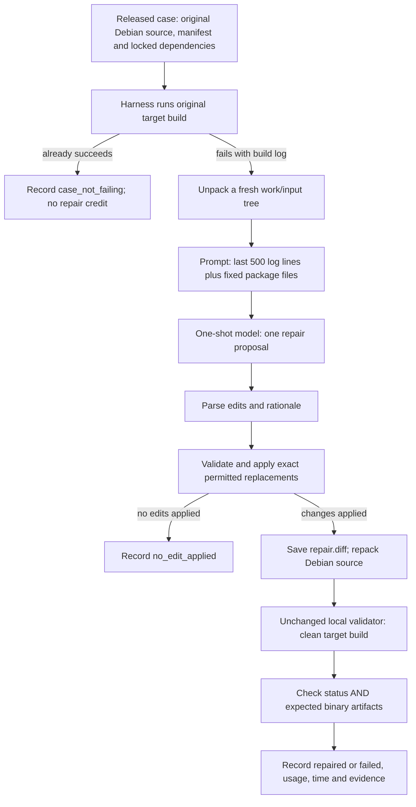
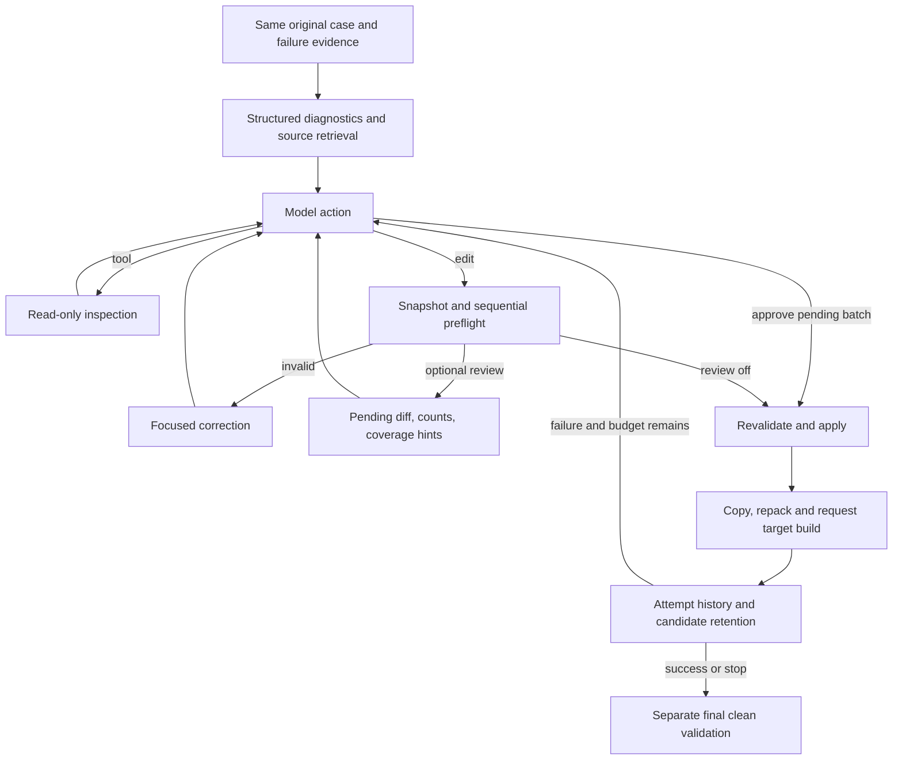

# Design Document — Demo 2 one-shot repair pipeline and evaluation

**Team:** Anthony Capraru, Austin Li, Joonseo Moon, Juliette Jacques, Owen Zhang
**Mentor:** Minghua Ma, Microsoft
**Demo 2 snapshot:** 19 October 2026; due on `demo-2`. Update this document for Demo 3 and the final.


This document describes the implemented local research pipeline through commit `001f3b9`, not only the original proposal. The main Demo 2 deliverable is the frozen one-shot repair pipeline and its public-case evaluation. The iterative full agent is a separate extension. TA entry points are `scripts/demo2_demo.py` for individual demonstrations and `scripts/demo2_retest.py` for the complete retest. The entry point adds reproducibility checks and records; it does not change either repair agent. Commit these files to `demo-2` before the TA clones it. Each run records its actual Git commit, source hashes, settings and outcome. Do not imply that results from earlier versions were produced by the current version.

**What works:** a real package can be unpacked, inspected, edited, repackaged and validated on ARM64. There are recorded live-model rcran repairs and a scripted full-agent failed-build/revision/success demonstration. **What does not yet work reliably:** autonomous repair of the harder development cases, including Rust Subversion. An assisted Rust repair builds successfully, but it is not an autonomous success. **The latest one-shot retest completed all ten development cases:** zero repairs, five failed candidate builds, four runs with no edit applied, and one case that already built unchanged. Rcran was tested separately and also failed in this repeat. See [the completed one-shot results](demo2-one-shot-results.md). The full-agent retest also completed all eleven evaluations and repaired rcran autonomously (1/11 overall, 0/10 bundle). Log review found all five reverse-direction cases blocked during environment setup in both arms. The four source-evaluable development cases remained unrepaired. See [the paired diagnostic review](demo2-comparison-diagnostics.md) for the complete case table, evidence and remaining work.

## 1. Architecture

### 1.1 Main Demo 2 architecture: the frozen one-shot pipeline



The one-shot pipeline is a complete LLM repair system, not a replay of the assisted Rust fix. It supplies an actual failing case to the model, applies the model's proposed source changes, and determines the outcome through an independent build. A negative result is still a completed evaluation when the run is recorded correctly. There is no minimum repair-rate promise for Demo 2.

#### What the frozen agent sees and does

1. `harness/run_case.py` reads the supplied case manifest and first runs the unmodified case. An already-building case is recorded as `case_not_failing`; it is not presented as a repair. Missing or invalid validator output is an environment error.
2. The harness runs `dpkg-source -x` into a fresh `work/input/`, keeping the upstream archive beside the tree for later repacking. The patch policy comes from the case, rather than from a model-selected path.
3. The one-shot agent receives the **last 500 log lines** and a predetermined source-file list. It does not run the full agent's diagnostic retrieval or tools. The fixed files are `input/debian/rules`, `input/debian/control`, `input/debian/patches/series`, `input/CMakeLists.txt`, `input/configure.ac`, `input/Makefile`, `input/setup.py`, `input/Cargo.toml`, and `input/meson.build`. Each file is bounded at 8 KiB; total file evidence is bounded at 32 KiB. Missing/truncated content is labeled. The log-tail line limit is not an equivalent byte/token cap: the libunwind baseline used over 104,000 input tokens in one call.
4. `agents/one-shot/src/model_client.py` requests one proposal from the configured model. Its output is a JSON object containing `edits` and `rationale`, rather than the full agent's `tool/edit/approve/stop` protocol. HTTP transport retries are not repair iterations: the agent never uses a failed candidate build to generate a second repair.
5. Each proposed edit contains `path`, `old_text`, and `new_text`. The frozen applier requires a unique literal match in an existing permitted UTF-8 file under `input/`. It rejects unsafe paths, missing or ambiguous text and unsupported changes. The later full-agent replace-all/review features do **not** modify this baseline. Rejections are recorded; the harness records proposed and applied counts separately.
6. If no edit applies, the run ends with `no_edit_applied`. Otherwise the harness saves the actual source diff before repacking. Some edits in a multi-edit proposal may be rejected; the final verdict concerns the changes actually applied.
7. The harness repacks with `dpkg-source --auto-commit -b`, assembles a case with original manifest/configuration/dependencies and modified source artifacts, and runs the supplied validator. This is necessary for Debian quilt packages: editing an unpacked file alone does not create the source package the local validator consumes.
8. Only a successful clean build **and** passed expected-artifact validation count as a repair. Every run, including a refusal, rejected proposal, failed build or infrastructure error, is recorded. There is no repair retry in one-shot.

For rcran, the original failure is an x86-only `xmmintrin.h` include enabled on ARM64. Recorded one-shot successes modified `debian/rules` to guard or remove that include before compilation. Those are model-generated build-time changes, distinct from the hand-authored direct-source replay fixture. The harness flags file-modifying build commands for manual review; a passing package alone does not establish ideal patch quality.

#### One-shot modules and boundaries

| Component | Code | Interface / responsibility |
| --- | --- | --- |
| Entry and repair orchestration | `agents/one-shot/src/main.py` | Read context, obtain one proposal, apply permitted edits; no build-feedback loop. |
| Failure evidence | `agents/one-shot/src/log_tail.py` | Extract the bounded-line log tail. |
| Model access and fixed evidence | `agents/one-shot/src/model_client.py` | Construct fixed prompt, call endpoint, parse edit plan and report usage. |
| Edit application | `agents/one-shot/src/edit_applier.py` | Literal replacements, path/file checks and rejected-edit logging. |
| Evaluation harness | `harness/run_case.py` | Original build, fresh extraction, actual diff, repack, clean final build and run record. |
| Outcome interpretation | `harness/record.py` | Require successful status and artifact check; do not use `patch_applied` as a success flag. |
| Repeated evaluation | `scripts/demo2_retest.py` | Fixed case/agent schedule, separate evidence directories, resume without hiding completed failures. |

Agent paths in this document are relative to `buildbench-starter-kit-0.1.0-rc.2/`. The baseline tag is `one-shot-v1`. Before the live retest the driver checks that `agents/one-shot/` has no tracked difference from that tag and records source hashes. It does not insert a known repair or change the baseline prompt. The supplied reference fix is used only by explicitly named replay controls.

### 1.2 Extension: iterative full-agent architecture



This extension adds structured diagnostics, tool use, multiple candidate builds, history and optional pre-build review. These features address failure modes observed in one-shot; they are not necessary to describe the baseline's operation, and their effectiveness must be measured separately. No model weights are trained during either workflow.

### 1.3 Full-agent components and contracts

| Component | Implementation | Responsibility |
| --- | --- | --- |
| Case materialization | `harness/run_case.py`, `harness/case_views.py` | Load a released environment; unpack the Debian source package into a fresh `work/input/`; retain original source and policy. |
| Diagnostics | `agents/full-agent/src/evidence.py` | Stream log evidence; remove validator timing prefixes; preserve Rust expected/found notes and locations; resolve compiler paths against actual source. |
| Tools | `agents/full-agent/src/tools.py` | Bounded read-only listing, finding, searching, file reading and inspection. The model receives labeled results and truncation notices. |
| Model adapter | `model_client.py`, `model_adapter.py`, `reply.py`, `prompts.py` | OpenAI-compatible HTTP requests, structured JSON actions, follow-up for malformed responses, prompt composition, token accounting and raw reply records. |
| Controller | `loop.py`, `contracts.py`, `candidates.py` | Budget checks, attempts, build feedback, history, candidate selection and snapshot restoration. |
| Edit validation | `edit_applier.py`, `edit_preflight.py`, `path_feedback.py` | Existing permitted UTF-8 files only; exact literal edits; sequential simulation; actionable rejection feedback. |
| Optional proposal review | `proposal_review.py` | Present pending diff, measured match counts, retained diagnostics and cross-file search hints before applying an approved batch. |
| Build adapter | `harness/build_feedback.py` | Copy candidate, repack its Debian source, run the organizer's local validator, parse feedback without modifying the agent's retained tree. |
| Results | `harness/record.py`, `harness/summarize.py` | Independent final verdict, append-only run records, timing, usage, failure reasons and diff classification. |

Agent module paths above are relative to `buildbench-starter-kit-0.1.0-rc.2/`. The harness is outside the submitted agent. Its Docker access and local credentials are host-side development facilities; the hosted build-feedback implementation is not established by a successful local run. This prototype uses a direct local callback, not the originally proposed file bridge.

### 1.4 Full-agent state, edits and correctness

A **model turn** is one controller interaction, sometimes including a same-turn corrective model call. It can request tools, propose edits, approve a pending review, stop, or be malformed. An **attempt** is a repair candidate considered by the loop; it is not interchangeable with a turn. A **build** invokes the validator. Several model turns can occur before any source changes or builds.

An edit names `input/...`, exact `old_text`, `new_text`, and optionally `replace_all: true`. Ordinary replacements must match uniquely. Replace-all is explicit, literal and limited to one named file; it is not a regex or permission to change every similar file. Edits are simulated in order, so later edits see earlier replacements. Paths outside policy, symlinks, ambiguous/missing text and no-op changes are rejected. A compiler path such as `src/client.rs` is evidence, not necessarily a valid edit path: the local worktree requires `input/src/client.rs`.

Invalid batches enter focused correction before writing or building. Review mode additionally requires model approval of the pending diff; approval is bound to the affected source snapshot and exact proposal. Changed source requires renewed review. Partial application in review mode is restored. Model approval establishes neither semantic correctness nor package success.

The loop ranks candidates using build success, stage reached and diagnostic count. These are retention heuristics; fewer diagnostics does not prove a correct repair. Snapshot restoration retains the selected candidate rather than treating every last edit as an improvement. The revised repeated-diagnostic stop rule permits continued work when the leading error is unchanged but other progress is observed.

The final success predicate is:

```text
validator status == "succeeded"
AND artifact_validation_passed == true
```

An applied edit, model claim, `status: completed`, or zero harness exit code does not establish repair. `patch_applied` is not the success predicate: this harness transports changes inside a rebuilt source package rather than the validator's separate patch mechanism.

## 2. Design decisions and failed approaches

### 2.1 Decisions defining the Demo 2 baseline

The one-shot baseline deliberately fixes the evidence policy and model interface so later improvements have a stable comparison. A small fixed file set is simpler and cheaper than repository exploration, but can omit the actual root-cause file. A single proposal makes cost and behavior easy to inspect, but a wrong path or repair cannot be corrected from compiler feedback. Literal edits avoid unconstrained shell execution by the agent, but demand exact source text the model may not have seen. Independent Debian repackaging and clean artifact validation make the outcome meaningful even when the proposed patch is plausible but wrong.

We considered a rule-based patch for each package and supplying the known successful Rust diff. Those can validate infrastructure or investigate feasibility, but are not an autonomous baseline evaluation. The live one-shot and full-agent retest receive no reference repair. Build-time commands proposed in `debian/rules` are allowed by the existing pipeline and flagged for review; they are not silently scored as safer than direct source changes.

### 2.2 Full-agent extensions and lessons from unsuccessful trials

| Decision | Alternative and observed tradeoff |
| --- | --- |
| Keep one-shot frozen | Changing its prompt after failures would move the baseline. `one-shot-v1` remains the comparison point; full-agent source is separate. |
| Exact edits and preflight | Blind or fuzzy replacement can touch unintended code. Exact matching exposed missing prefixes, duplicate proposals and ambiguous snippets; the controller now returns precise correction feedback. |
| Preserve compiler detail | Early Rust summaries discarded expected/found argument notes and merged distinct locations. Retaining those notes improves available evidence, but has not yet produced an autonomous Rust success. |
| Include complete diagnosed source when it fits | The original bounded retrieval approach sometimes caused repeated inspection. Current source inclusion allows two files, at most 64,000 bytes each and 100,000 total. An offline check found both entire `client.rs` and `delta.rs` present in a 98,655-character request. This disproved the assumption that every failure was caused by missing those files. Other affected files still require discovery. |
| Iteration with independent builds | A one-shot cannot revise from its own compiler failure. Full-agent attempts can, but investigation and correction often consume the budget before a build. |
| Small-group strategy was tested | Three-edit groups produced valid incremental changes but addressed too little of a package-wide cause. Three builds reduced Rust diagnostics from 103 to 95 without repairing it. It is not the default demonstration strategy. |
| Shared-cause strategy is opt-in | It asks the model to inspect shared producers/consumers across files. It removes the three-edit grouping, but does not automatically discover or fix all affected locations. |
| Explicit replace-all and pre-build diff review | Repeated pointer-type fixes motivated whole-file literal replacement with measured counts and cross-file coverage hints. A valid review can still omit files; coverage is bounded search, not semantic proof. |
| Retain budgets, record exploratory increases | Rust experiments used 100k, 200k and 300k token ceilings and 20/30 turns; a later run allowed 1M tokens, 80 turns and ten loop builds. More allowance alone did not solve erroneous or redundant edits. These are different exploratory configurations, not controlled improvement comparisons. |
| Snapshot/copy before building | Debian `3.0 (quilt)` repacking creates patch metadata. Building a copy keeps these generated changes out of the agent's retained source and repair diff. `dpkg-source --auto-commit -b` avoids an interactive patch-recording step. |
| JSON actions in reply text | Provides an explicit controller protocol without requiring native tool-calling support. Malformed reasoning-only responses remain a measured failure mode. |

A concrete unresolved failure at `001f3b9`: the model first replaces every `*const i8`, then asks to replace `as *const i8` in the same file. The second text no longer exists in the simulated result. Focused correction repeatedly resubmitted the redundant operation, so no batch reached review or build. A separately prepared recovery patch removes only redundancies proven equivalent by whole-file simulation; it is **not assumed installed or live-validated by this document**.

The assisted Rust repair replaced 55 C pointer-type occurrences across seven files with the platform's `std::os::raw::c_char`. This fixed shared wrapper interfaces as well as call sites and produced a package. It demonstrates that editing permitted source is sufficient; it does not show that the autonomous agent found that scope. A model given the worked solution still omitted `string.rs`; assistance supplied its two missing replacements. That second successful build is example-assisted, not independent generalization.

### 2.3 Resource configuration

Committed full-agent defaults at the documented code milestone: five attempts, three loop builds, 100,000 reported model tokens, 1,800 seconds with a 120-second reserve, 20 model turns and 30 tool calls. A baseline build and final validation are additional harness work. Default investigation allows six consecutive tool turns; small-group mode uses two. Token ceilings are checked around calls, so the last request can overshoot; missing usage is unknown, not zero. Build subprocesses have their own manifest timeout and harness margin; the agent clock is not a hard kill of the entire experiment.

The TA wrapper uses the source defaults actually present and records them in `settings.json`. It resets inherited ablation/strategy/review/trace settings explicitly. It does not silently raise limits or edit source. The `--review` option activates shared-cause investigation and proposed-diff review for a live full-agent run only. Default controls and replay use review off, because scripted replies do not contain approval actions.

## 3. Setup from a clean AWS instance

This guide uses only the **rcran-v1** and **development-v1 ten-case validator bundles**, plus this repository. The bundles contain their runtime images, original sources, target configurations and frozen dependencies. Do not download the general 200-case development dataset, a separate runtime image release, or an assisted repair.

The recorded evaluation used code commit `001f3b9dd15f89665794609c8b04b73acfae167e`. The helper below restores that source and the saved full-agent limits in a separate directory. It does not promise identical model outputs or an identical host environment. The new TA wrappers have offline tests; this fresh-instance walkthrough still needs a real acceptance run.

### 3.1 Access and instance

You need repository access, permission to download the official bundles, and for live runs an AWS identity permitted to invoke the recorded Bedrock model. Neither bundle nor model credential is stored in Git. Replay controls need no model credential but still perform real local builds.

Use Ubuntu Server **24.04 LTS, ARM64**, on a Graviton instance. The recorded host was an `m7g.xlarge` with 4 vCPUs, 16 GiB RAM and 80 GiB storage; use at least that capacity and monitor free disk space. Use a disposable evaluation host with sudo and Docker access. Allow outbound HTTPS for GitHub, package repositories, bundle downloads and Bedrock. SSH access is needed if using the SSH examples; restrict inbound SSH to your own address. No public application port is required. AWS charges are the evaluator's responsibility; stop the instance when finished and retain results first.

On the new **EC2 Linux terminal**:

```bash
sudo apt-get update &&
sudo apt-get install -y git python3 docker.io dpkg-dev xz-utils gzip tar ca-certificates tmux qemu-user-static binfmt-support &&
sudo systemctl enable --now docker &&
sudo usermod -aG docker "$USER"
```

Log out and reconnect, then:

```bash
uname -m
docker info --format '{{.Architecture}}'
python3 --version
dpkg-source --version
df -h "$HOME"
mkdir -p "$HOME/Downloads"
git clone --branch demo-2 https://github.com/ec528-fall26/build-bench.git "$HOME/build-bench-demo2"
cd "$HOME/build-bench-demo2" &&
git fetch origin --tags &&
git rev-parse HEAD &&
git status --short
```

`uname -m` must report `aarch64`. Python 3.12 on Ubuntu 24.04 is suitable; the harness uses the standard library, so no pip install is required. Record the handoff commit printed above. If the repository is private, authenticate using your approved GitHub access; do not embed tokens in a saved clone URL. Host package versions are not fully pinned by this guide.

### 3.2 Download exactly two official bundles

Open [Build-Bench Data & Downloads](https://matrix.cstcloud.cn/build-bench/data-downloads.html):

| Website row | Version | Select |
| --- | --- | --- |
| Local Validator Example | rcran-v1 | Download local example; also Checksums and Local validation guide |
| Local Validator Bundle: 10 Cases | development-v1 | Download bundle; also SHA-256 and Guide |

Use the official page's links rather than guessed URLs. Website authentication and direct-link availability were not independently verified during preparation. The TA must confirm download access before evaluation. The ten-case archive is approximately 2.29 GB. Verify downloaded archives against the published checksums; if filenames or hashes differ, stop and confirm the release rather than substituting another dataset.

If downloading through your laptop's browser, transfer the archives to EC2. In your **laptop terminal**, replace the key path and IP with those of your own instance:

```bash
scp -i /path/to/your-ec2-key.pem \
  "$HOME/Downloads/buildbench-local-rcran-v1.tar" \
  "$HOME/Downloads/buildbench-local-development-v1.tar" \
  ubuntu@YOUR_EC2_PUBLIC_IP:/home/ubuntu/Downloads/
```

The following commands assume those archive filenames. If the official download uses a different extension, inspect it and follow its accompanying guide; do not merely rename compressed formats. On **EC2**, extract into new directories, verify the internal checksums and load the bundled images:

```bash
test ! -e "$HOME/buildbench-local-rcran-v1" &&
tar -xf "$HOME/Downloads/buildbench-local-rcran-v1.tar" -C "$HOME" &&
cd "$HOME/buildbench-local-rcran-v1" &&
sha256sum -c SHA256SUMS &&
docker load -i runtime-image.tar.gz &&
bash run.sh --check
```

```bash
test ! -e "$HOME/buildbench-local-development-v1" &&
tar -xf "$HOME/Downloads/buildbench-local-development-v1.tar" -C "$HOME" &&
cd "$HOME/buildbench-local-development-v1" &&
sha256sum -c SHA256SUMS &&
docker load -i runtime-image.tar &&
bash run.sh --list
```

These are the recorded bundle layouts. Stop on any missing file, checksum error or failed preflight. `--check` does not prove a real build works. Keep the archives outside Git.

### 3.3 Offline checks, then the recorded source profile

First test the unmodified handoff checkout; tests that assume default limits must run before preparing the historical enlarged-budget profile:

```bash
cd "$HOME/build-bench-demo2" &&
env -u BB_MODEL_TRACE -u BB_REPAIR_STRATEGY -u BB_REVIEW_EDITS \
  -u BB_AGENT_USE_EVIDENCE_MANAGER -u BB_AGENT_USE_TOOLS \
  -u BB_AGENT_USE_BUILD_FEEDBACK -u BB_AGENT_USE_HISTORY \
  python3 -m unittest discover -s tests/full-agent -p 'test_*.py' &&
python3 -m unittest discover -s harness/tests -t . &&
python3 -m unittest discover -s tests/demo2 -p 'test_*.py' &&
python3 scripts/demo2_evidence_report.py
```

Prepare the separate checkout. Do not point `--out` at an existing directory:

```bash
python3 scripts/demo2_prepare_recorded.py --out "$HOME/build-bench-demo2-recorded" &&
cd "$HOME/build-bench-demo2-recorded" &&
cat ta-recorded-profile.json &&
python3 -m harness.case_views "$HOME/buildbench-local-development-v1" "$HOME/bb-cases"
```

The helper checks out the historical commit, applies only the saved budget diff, verifies every recorded full-agent Python source hash and checks the one-shot tag. The settings are 12 attempts, 10 loop builds, 1M reported tokens, 7,200 seconds, 120 seconds reserve, 80 turns and 200 tool calls. The runner sets default strategy, history on and review off; no reference repair is supplied in live mode. Baseline and final validation builds are additional harness work. A model call can overshoot the token threshold.

Do not commit the prepared checkout's intentional local budget modifications. Record its `ta-recorded-profile.json` with the results. Source verification does not pin host kernel, Docker, QEMU or model-serving changes.

## 4. Running and verifying the experiments

### 4.1 Prove the rcran pipeline without a model key

Start a persistent session on EC2:

```bash
tmux new -s demo2-ta
```

Inside that session:

```bash
cd "$HOME/build-bench-demo2-recorded" &&
python3 scripts/demo2_demo.py controls \
  --bundle "$HOME/buildbench-local-rcran-v1" \
  --out "$HOME/buildbench-experiments/ta-rcran-controls-01"
```

Expected: the positive known-fix control produces a verified repair; the negative comment-only control applies a change and fails its build. Both results must be recorded. These are scripted infrastructure controls, not autonomous successes. Inspect the new output directory's `summary.json`, console logs and `runs/*/record.json`. Stop and diagnose if either control fails its expected check. Reconnect with `tmux attach -t demo2-ta`.

### 4.2 Short-term Bedrock API key for live runs

Use a **short-term Amazon Bedrock API key generated in us-east-1**. In the AWS Bedrock console choose the region, then **API keys → Short-term API keys → Generate short-term API keys**. The generating identity needs permission to use the model. AWS documents that the key inherits that identity's permissions, is region-specific, and expires at the earlier of the session expiry or 12 hours. See [AWS key-generation instructions](https://docs.aws.amazon.com/bedrock/latest/userguide/api-keys-generate.html).

Generate the key shortly before starting the live evaluation. A long schedule may exceed its lifetime. Do not put it in Git, a script, a URL, a screenshot or an evidence archive. Paste it with hidden input **inside the same EC2 tmux shell** that launches the run:

```bash
set +x
read -r -s -p 'Paste short-term Bedrock API key for us-east-1: ' BB_MODEL_API_KEY
export BB_MODEL_API_KEY
printf '\n'
export BB_MODEL_BASE_URL='https://bedrock-runtime.us-east-1.amazonaws.com/openai/v1'
```

The historical agent fixes the model ID to `openai.gpt-oss-120b-1:0`; the wrappers do not substitute a newer model. This uses the Bedrock OpenAI-compatible endpoint, not an OpenAI account key. A correctly formatted key is not proof of authorization. A 401/403, expired key, unavailable model or endpoint error is an execution problem, not a source-repair result.

### 4.3 Live evaluation: rcran plus the ten cases

The full schedule contains 22 jobs, one repeat per agent per case, with rcran first. The new scheduler interleaves agents; the archived evaluations ran the one-shot arm and full-agent arm separately. Source, limits and case identities are reproduced; scheduling and model outcomes are not asserted identical.

Enable the reverse-direction handler:

```bash
sudo update-binfmts --enable qemu-x86_64 &&
cat /proc/sys/fs/binfmt_misc/qemu-x86_64
```

It must be enabled and include `F` in flags. **This check alone is insufficient:** in the recorded run all five x86-target cases encountered QEMU/setup crashes before package compilation. The pipeline retains these outcomes. Do not report them as five established source-repair failures or promise that the TA's host fixes them.

Inspect the schedule without model calls or builds:

```bash
cd "$HOME/build-bench-demo2-recorded" &&
python3 scripts/demo2_retest.py \
  --rcran "$HOME/buildbench-local-rcran-v1" \
  --views "$HOME/bb-cases" \
  --out "$HOME/buildbench-experiments/ta-paired-recorded-01" \
  --dry-run
```

Then launch all 22 jobs:

```bash
python3 scripts/demo2_retest.py \
  --rcran "$HOME/buildbench-local-rcran-v1" \
  --views "$HOME/bb-cases" \
  --out "$HOME/buildbench-experiments/ta-paired-recorded-01"
```

Expect progress lines and `coverage.json`, `results.md`, `plan.json`, and per-job evidence under `jobs/`. An unchanged successful build is not a repair. A valid live failed repair is retained, not retried until success. The complete schedule can take hours; individual manifest build timeouts differ and two allow four hours. Quiet output during compilation is normal.

After interruption, refresh an expired key in the same shell and add `--resume` to the same command, without changing code, endpoint, Python or case files. Resume skips jobs with completed summaries, including failures. **It does not automatically retry a completed authentication-error job.** Keep that evidence and run any deliberate retry into a fresh output directory, clearly labeled, rather than deleting records or combining retries into the original score.

For a shorter live demonstration instead of the full schedule, run these separately with fresh output directories:

```bash
python3 scripts/demo2_demo.py live-one-shot \
  --bundle "$HOME/buildbench-local-rcran-v1" \
  --out "$HOME/buildbench-experiments/ta-rcran-one-shot-01"
python3 scripts/demo2_demo.py live-full \
  --bundle "$HOME/buildbench-local-rcran-v1" \
  --out "$HOME/buildbench-experiments/ta-rcran-full-01"
```

The recorded single repeat was one-shot 0/11, full agent 1/11 (rcran), with five setup-blocked and one already-building case per arm. Model behavior is nondeterministic; an identical score is not the acceptance criterion. Require valid records and actual clean-build/artifact verification for every claimed repair.

### 4.4 Preserve evidence and assess readiness

Retain the handoff commit, prepared profile, plan, settings, records, patches, baseline/candidate/final logs and summaries. Check that a claimed success has both validator success and passed expected-artifact validation. Review setup-stage failures separately. Stop the AWS instance after exporting the evidence.

Handoff acceptance remains pending until a fresh host passes bundle verification, offline tests, both real rcran controls and at least one recorded live invocation. The code/document update itself did not provision AWS, test website account access, call Bedrock or build packages. The five reverse cases and hosted competition qualification remain separately unresolved.
## 5. Claims, milestones and limitations

### 5.1 Milestone accountability

| Original commitment | Current evidence/status | Remaining work |
| --- | --- | --- |
| Demo 2: compatible end-to-end LLM prototype and materialized Debian trace | **Local prototype demonstrated.** rcran live repairs documented; model/tool/edit/build records implemented. Commands above expose both controls and live paths. | No additional implementation required for this local prototype milestone. |
| Demo 2: runnable packaged agent; starter compatibility documented | **Local harness is not hosted qualification.** Agent entrypoint and kit packaging exist, but this document has not verified current `bb ready`/Hosted Smoke Test success. | Run and retain current packaging/compatibility checks; report any blocker. Do not replace them with unit-test counts. |
| Demo 2: freeze/evaluate ten public cases, aiming five per direction | **Coverage complete for both agents, one repeat per case.** One-shot bundle: five `build_failed`, four `no_edit_applied`, one `case_not_failing`; zero repairs. Full agent: zero bundle repairs, plus a verified rcran repair. Original records and plans are imported. | Five reverse cases failed during environment setup in both arms; rerun their intended source failures after fixing setup. Keep the unchanged case separate. This is not the future controlled repeated comparison. |
| Demo 3: history-based revision and ablation | Loop/history implemented early; scripted revision works and live Rust attempts show sequential changes. | Controlled history-on/off comparison with common settings on the frozen set; no measured history benefit claimed yet. |
| Demo 3: measurable improvement | **Not demonstrated.** Both recorded arms are 0/12 on the four harder cases. | Freeze version/budgets, run planned paired repeats, report gains and regressions. |
| Final: 40-case evaluation and second targeted improvement | Future work, not completed by this prototype. | Preserve package-group holdout and avoid tuning on held-out cases. |

The proposal explicitly promised **no minimum Demo 2 repair rate**, but did promise evaluation coverage and a runnable prototype. Successful rcran demonstrates a real capability. Ten-case evaluation completion depends on recorded coverage, not repair count; packaging verification is a separate obligation. Announce any milestone revision rather than silently changing the denominator.

### 5.2 Claims supported and not supported

**Fresh-instance reproducibility:** The evaluations ran on the team's configured EC2 instance. The consolidated fresh-instance setup instructions have passed offline checks but have not yet been validated end to end on a new instance. This is a handoff-verification limitation; it does not undo the completed local prototype demonstration or recorded evaluations.


Supported: real end-to-end local repair/build machinery; positive and negative replay controls previously verified; documented live rcran successes; detailed negative evidence on harder cases; an assisted Rust build demonstrating source-level feasibility.

Not supported: general superiority over one-shot, a causal benefit from repair history, autonomous Rust success, RISC-V/hidden-case performance, current hosted qualification, or reliable success on every live rerun. Passing builds establish benchmark build/artifact criteria, not exhaustive functional correctness or unchanged behavior on every architecture.

The latest full-agent rcran success is verified from the newly imported paired archive, including its final artifact check. The older raw rcran live records were not included in the supplied 24-run archive. The rcran historical claims above cite `part5-findings.md` §§9a/9c and should be strengthened by checking in the corresponding compact raw records. The four full-agent rcran runs vary in settings, and temperature 0 did not remove variation in one-shot runs. Do not advertise 4/4 as a controlled superiority comparison against 1/3.

The `rust-assisted-cchar-v1` experiment succeeded at packaging with zero diagnostics in 163.0 seconds. The example-assisted completion succeeded in 168.9 seconds. Neither receives autonomous credit. Ground-truth agreement with the separate website Development Validation process has not been demonstrated here.

Known limitations include repeated prompt cost, limited cross-file reasoning, stale/duplicate model edits, limited output budgets, incomplete tool/model-protocol compliance, unknown usage on some calls, and coarse high-level failure classification. A previous Unicode line separator in an API key caused a request-encoding failure mislabeled at the summary level as no edit applied. The new TA wrapper rejects that key format and surfaces model errors, without claiming to repair every upstream classification issue.

### 5.3 Findings from the completed paired retest

The full diagnostic review is [Demo 2 comparison diagnostics](demo2-comparison-diagnostics.md). Both plans record commit `001f3b9dd15f89665794609c8b04b73acfae167e`. The full agent used default strategy, history on and **proposal review off**, with local limits of 1M tokens, 80 turns, 10 loop builds, 12 attempts, 200 tool calls and 7,200 seconds. The TA scripts use recorded source defaults; they do not reproduce these elevated limits automatically. Optional review and shared-cause features were not evaluated by this paired run.

| Latest evidence | One-shot | Full agent |
| --- | ---: | ---: |
| Scheduled cases processed | 11 | 11 |
| Verified repairs across all cases | 0 | 1 (rcran) |
| Development bundle repairs | 0/10 | 0/10 |
| Source-evaluable development cases repaired | 0/4 | 0/4 |
| Reverse-direction cases blocked in setup | 5 | 5 |
| Already-building cases | 1 | 1 |

The full agent changed `HAVE_MM_PREFETCH` from 1 to 0 in the rcran configuration header; separate final validation produced the expected ARM64 `.deb`. One-shot's failed build-time edit remains in the results. This is one positive local demonstration, not a reliability guarantee or causal proof about history.

Frozen dependencies and a validator runtime did not prevent host/emulation setup crashes. All five x86-target baseline logs contain QEMU crashes and finish in setup/infrastructure failure. Their underlying intended source defects were not evaluated successfully. The high-level harness categories can mislabel such runs as ordinary build failures or no edit; future reporting must retain raw verdicts while exposing stage-based categories.

Immediate work is to qualify the reverse-direction environment, improve stage classification and proposal accounting, and test edit-correction changes against saved failures. Later work is controlled repeats/history ablation, hosted compatibility validation and broader cases. The Rust full-agent run exhausted twelve correction responses before applying a batch; its zero proposed-edit summary does not mean the model never proposed edits. Increasing token limits alone has not established a solution.

### 5.4 Handoff acceptance checklist

Before the team calls the handoff ready:

- Commit this document, driver, driver tests and compact evidence to `demo-2`; record the full commit used by the TA.
- Provide repository and validator-archive access; verify bundle checksums on the TA host.
- Run both replay commands on that commit and preserve their real build results. Run at least one live rcran example and preserve its actual outcome, even if it fails.
- Verify current packaged-agent checks and report hosted/local boundaries honestly.
- Preserve the imported 22 run records and the paired diagnostic table. Keep setup-blocked cases, the unchanged successful case, genuine source-repair failures and the rcran repair distinct. Re-run the five reverse cases after environment qualification; keep assisted successes separate.
- Keep credentials, unpacked dependency bundles and build trees out of Git and the submitted agent ZIP.

The accompanying drivers were tested offline during document preparation. No new EC2 build or paid model experiment was performed by preparing these files. A passing clean-machine walkthrough is the remaining acceptance gate, not an assumed result.

### Source map

- `design-proposal.md`, milestones §5: original commitments and no-minimum-rate scope.
- `part5-findings.md` §§9a–9d: frozen baseline, full-agent rcran and initial development-case observations (historical notes contain some stale planning text).
- `harness/README.md`, `harness/run_case.py`, `harness/build_feedback.py`, `harness/record.py`: executable build/result contract.
- `reviewed-repairs.md`: optional replace-all and proposed-review semantics.
- `evidence/demo2/comparison-records.json`: older compact 24-run archive evidence; not the new ten-case run.
- `demo2-one-shot-results.md` and `evidence/demo2/one-shot-retest-summary.json`: completed eleven-case one-shot aggregate verified against imported original records. The paired-retest evidence contains both plans, summaries, all 22 records, actual patches and line-numbered log excerpts.
- Organizer bundle READMEs and manifests: pinned runtime/dependencies and platform requirements. No current external policy/date claims are inferred from older proposal notes.
